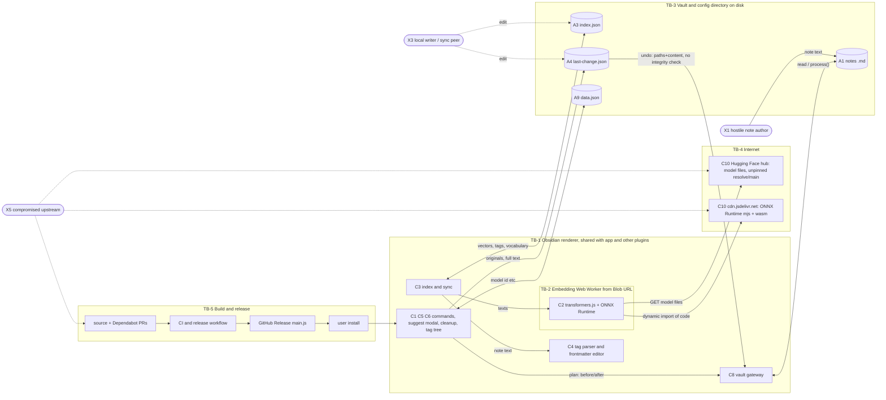

# Tagafinity threat model

| | |
|---|---|
| **Method** | STRIDE threat model backed by an active threat hunt. Every finding marked *Confirmed* was reproduced with a working proof of concept (PoC) in the run that produced this document. |
| **Product / version reviewed** | Tagafinity (Obsidian desktop plugin) **0.3.10**, `manifest.json` `isDesktopOnly: true` |
| **CODE_PIN** | `5d062b97b397d08e32b5f5cbfafa589b323a3477` (all `file:line` citations refer to this commit) |
| **Mode / date** | CREATE, 2026-10-25 |
| **Status** | **DRAFT, awaiting maintainer review.** Not self-merged. |
| **Test environment** | Ubuntu 24.04.5 LTS, Linux 6.18.44 x86_64 · Node v24.11.0 / npm 11.6.1 (the project pins Node 24 in `.nvmrc`) · vitest 5.0.5 · TypeScript 6.0.3 · esbuild 0.28.2 · `js-yaml` 4.3.2 (YAML oracle) · Playwright 1.63.0 with Chromium 153.0.8010.12 (browser PoCs). Real Obsidian (Electron) was **not** available; see AS-9. |
| **Baseline** | `npm ci --ignore-scripts` then `npx vitest run`: 24 files, 326 tests passed on the pin. `npm run build` succeeded (main.js 2,222,497 bytes). |
| **Scope limits** | Network policy blocked `huggingface.co` and `cdn.jsdelivr.net` (HTTP 403 from the sandbox proxy), so no real model could be downloaded. All browser PoCs intercept those hosts locally; no traffic left the sandbox. Inference with a real model was therefore **not** exercised (see CL-5). |

Contents: 1 How to use · 2 System overview · 3 STRIDE matrix · 4 Confirmed findings · 5 Full register · 6 Existing controls · 7 Security invariants · 8 Recommendations · 9 PoC registry · 10 Claims register · 11 Review log

---

## 1. How to use this document

**Purpose.** Engineers consult this before changing architecture, so security-relevant decisions are made against known threats and so each PoC can be re-run to detect regressions or fixes.

### 1.1 When you MUST re-read and update it

| Change type | Why it triggers a re-read | Typical sections to touch |
|---|---|---|
| New or changed sink: anything that writes a note, evaluates code, renders HTML, spawns a process, opens a URL, or builds a path/regex from data | New path from untrusted note text to a privileged action | 3, 4/5, 7, 9 |
| New network endpoint, new outbound fetch, new model host, new CDN or runtime download | Changes TB-4 and the supply chain (E-1, T-1) | 2, 5, 7 (V-1, V-2) |
| New persisted data or new file in the plugin directory, or a change to what `index.json` / `last-change.json` / `data.json` contain | Changes confidentiality at rest (I-1, I-2) and tamper surface (T-7, D-3) | 2, 5, 7 |
| New capability to launch/open/write: commands that modify notes, protocol handlers, file/URL openers, clipboard, drag/drop | Integrity of user data (T-3, T-6, T-11) | 3, 5, 7 |
| Change to any regex/parser that runs on note text (`src/tags/*`, `src/text/*`) | D-1, T-3, T-5 live here | 4, 7 (V-9), 9 |
| Change to `.github/workflows/*`, `esbuild.config.mjs`, `scripts/*`, `justfile`, Dependabot config, branch/tag protection | Release boundary (TB-5): E-2..E-5 | 2, 5, 7 |
| New dependency, especially with install scripts, native code, or runtime downloads; a bump of `@huggingface/transformers` / `onnxruntime-*` | Changes what ships and what is fetched at runtime | 5 (dependency table), 7 |
| Relaxing or removing a control listed in section 6 | Control inventory is the baseline | 6, 7 |
| New or changed security-relevant claim in README/UI text | Claims register | 10 |

**PR rule.** Every pull request description must contain exactly one line:
`Threat model: no impact` or `Threat model: updated (IDs)`, for example `Threat model: updated (E-1, V-2)`.

### 1.2 Conventions

* IDs are stable and never reused: assets **A**n, adversaries **X**n, trust boundaries **TB**-n, components **C**n, claims **CL**-n, assumptions **AS**-n, threats **S/T/I/D/E**-n, repudiation threats **RP**-n (so they do not clash with recommendations **R**-n), disproved hypotheses **H**-n, invariants **V**-n, informational notes **N**-n, PoCs **POC**-nn.
* `file:line` citations are valid **only** at CODE_PIN. After the code moves, update CODE_PIN and re-check them (the check script is described in 9.8).
* Ratings combine likelihood and impact (1.3). When impact is high but a precondition is required, the precondition is stated.

### 1.3 Rating scale

| Rating | Meaning |
|---|---|
| **Critical** | Code execution or unrecoverable mass loss/disclosure of user data reachable by a remote or unauthenticated party with at most a routine user action (opening a note, clicking a command). |
| **High** | Code execution or unrecoverable data loss with a realistic precondition, **or** Critical impact whose likelihood is Low (needs an upstream or CDN compromise). |
| **Medium** | Recoverable corruption of user data; denial of the whole app by one hostile input; disclosure of private vault data to places with weaker protection; plausible preconditions. |
| **Low** | Minor integrity, availability or privacy effect; needs unusual preconditions or an attacker who is already privileged; defence-in-depth. |

### 1.4 Status vocabulary (used exactly)

| Status | Meaning |
|---|---|
| **Confirmed** | Reproduced in THIS run with a working PoC (positive control present; negative control where relevant). |
| **Reasoned** | Found by reading code or configuration; not exercised. |
| **Mitigated** | A control exists and was checked to work. |
| **Accepted** | Inherited from the platform or a deliberate trade-off (the decision-maker is named). |
| **Disproved** | A hypothesis that was tested and did not hold. Kept on purpose (section 5.7). |

---

## 2. System overview

### 2.1 What it does

Tagafinity is an Obsidian **desktop-only** plugin. It embeds every note locally with transformers.js (`Xenova/all-MiniLM-L6-v2` by default, `src/embeddings/transformers.ts:10`), stores the vectors, tags and a term-frequency table in `index.json`, suggests tags for the active note from its nearest neighbours, and offers a tag-cleanup workflow (merge, rename, nest, remove) that rewrites frontmatter and inline `#tags` across notes with a line-level preview and a one-level undo. The plugin makes **no network calls of its own** (sweep in POC-28); the only outbound traffic comes from the bundled transformers.js / ONNX Runtime Web library, which downloads the model from the Hugging Face hub and (as found here) executable runtime code from jsdelivr.

The plugin has no server, no accounts, no credentials and no telemetry.

### 2.2 Assets

| ID | Asset | Why it matters |
|---|---|---|
| A1 | Note content and frontmatter in the vault | The user's data: integrity (rewrites) and confidentiality |
| A2 | Note metadata: paths/titles, tag names | Reveals structure and topics of private notes |
| A3 | Derived index (`index.json`: vectors, tags per note, vocabulary table) | Plaintext derivative of the vault; lives in the config directory |
| A4 | Undo store (`last-change.json`) | Full pre-change text of every touched note |
| A5 | Obsidian process privileges (full Node/Electron access as the OS user) | Any code that runs in the plugin context inherits it (AS-1) |
| A6 | Release artifact integrity (`main.js`, `manifest.json`, `styles.css` on GitHub Releases) | What users install; compromise reaches A5 on every install |
| A7 | Availability of Obsidian's UI thread and of the plugin features | A hung renderer blocks all notes |
| A8 | Embedding model files and ONNX Runtime code | Determines both suggestion quality and what code executes |
| A9 | Plugin settings (`data.json`) | Includes the model id that selects what is downloaded |
| A10 | Repository write access and the release job's `GITHUB_TOKEN` (`contents: write`) | Ability to publish A6 |

### 2.3 Adversaries

| ID | Adversary | Capability assumed |
|---|---|---|
| X1 | Hostile note author | Can get text into a vault (shared vault, sync peer, Web Clipper, email/import, pasted content). No code execution. |
| X2 | Co-resident plugin/code in Obsidian | Already full privilege (AS-1); relevant only for what Tagafinity *adds* (persistence, stealth, trust in shared state). |
| X3 | Local process or user with file write access to the vault/config directory | Malware without Obsidian code execution, a sync peer, another OS user, a cloud-sync conflict. Can edit files such as `last-change.json`. |
| X4 | Network attacker | Can intercept or alter traffic to model/CDN hosts (TLS and DNS permitting). |
| X5 | Compromised upstream | npm package, Hugging Face repo owner, jsdelivr, a GitHub Action. |
| X6 | Malicious or compromised contributor | PR author, maintainer account, bot account, merged Dependabot PR. |
| X7 | Phisher / social engineer | Persuades a user to set a model id or install a look-alike. |
| X8 | Device thief | Reads files at rest. |

### 2.4 Components

| ID | Component | Main files |
|---|---|---|
| C1 | Plugin shell, commands, settings | `src/main.ts`, `src/settings.ts` |
| C2 | Embedding runtime: Blob worker, main-thread fallback, bundled transformers.js + ONNX Runtime Web | `src/embeddings/*`, `esbuild.config.mjs` |
| C3 | Index and sync (hashing, tf table, checkpoints) | `src/index/*`, `src/text/*` |
| C4 | Tag parser and transformer, frontmatter editor | `src/tags/*` |
| C5 | Suggestion engine and suggest modal | `src/suggest/engine.ts`, `src/ui/suggest-modal.ts` |
| C6 | Cleanup, taxonomy, tag tree, preview, apply and undo | `src/cleanup/*`, `src/taxonomy/*`, `src/ui/*` |
| C7 | Persisted state in the plugin directory | `data.json`, `index.json`, `last-change.json` |
| C8 | Vault gateway (Obsidian API) | `src/vault/*` |
| C9 | Build, CI, release, dev scripts | `.github/*`, `scripts/*`, `justfile`, `esbuild.config.mjs` |
| C10 | External services: Hugging Face hub (model files), cdn.jsdelivr.net (ONNX Runtime JS+WASM) | outside the repo |
| C11 | Diagnostics (debug log, stall monitor, clipboard export) | `src/log.ts`, `src/stall-monitor.ts` |

### 2.5 Trust boundaries

| ID | Boundary |
|---|---|
| TB-1 | Obsidian renderer process: Tagafinity shares it, its origin and its caches with the app and every other plugin ("same-process-other-code") |
| TB-2 | Embedding Web Worker created from a Blob URL (runs library code; Electron may expose Node there, see AS-1) |
| TB-3 | Vault and config directory on disk: shared with sync tools, git, backups and other processes |
| TB-4 | Internet: Hugging Face hub and jsdelivr |
| TB-5 | Build and release: source and Dependabot PRs → CI → GitHub Release → user install |

### 2.6 Data-flow diagram



### 2.7 Assumptions to verify (AS-n)

| ID | Assumption (not verified in this run unless stated) | Findings that depend on it |
|---|---|---|
| AS-1 | Plugins run in Obsidian's Electron renderer with the OS user's full privileges. Evidence in the repo: `src/embeddings/worker.ts:6` says Electron can expose Node's `process` inside workers, so worker code may also have Node access. | E-1 (impact), E-6, T-12 |
| AS-2 | `Vault.getAbstractFileByPath` only returns files known to the vault index (not hidden `.obsidian/**` files) and `Vault.process` can rewrite any `TFile`, including non-markdown ones. The gateway checks `instanceof TFile` only (`src/vault/obsidian-gateway.ts:13`). | T-7 |
| AS-3 | Obsidian imposes no CSP that blocks dynamic `import()` of https scripts or Blob workers. Inferred from the plugin working as designed; Chromium 153 PoCs allowed both. | E-1, POC-25 |
| AS-4 | GitHub Actions substitutes `${{ }}` expressions textually into a `run:` script before the shell sees it (documented behaviour). POC-26 mirrors that substitution. | E-3 |
| AS-5 | Branch protection, required reviews, tag protection and the identity/permissions of whatever adds the "chore: update version" commits to PRs are **unknown**; not visible with the access available in this run. | E-2, E-4, RP-2 |
| AS-6 | Obsidian's own YAML and Markdown semantics (multi-line flow sequences are valid; quoted scalars stay strings; double-backtick spans, 4-backtick fences and nested link parentheses are code/links per CommonMark) match `js-yaml` 4.3.2 core schema and CommonMark. | T-3, T-4, T-5 |
| AS-7 | The Obsidian community store and BRAT install the release assets from GitHub Releases without verifying a signature beyond store review. | S-2, E-4, RP-2 |
| AS-8 | Cache Storage and the HTTP cache are shared by all code in Obsidian's renderer origin. | T-2 |
| AS-9 | Real Obsidian (a different Electron/Chromium build) behaves like the Chromium 153 used in the PoCs for Workers, dynamic import and the Cache API. Results may differ on the real runtime. | E-1, T-2, POC-22..25 |
| AS-10 | Hugging Face and jsdelivr are not compromised today and serve over TLS. Not verifiable (no network). | E-1, T-1 |
| AS-11 | Users may sync or version `.obsidian/plugins/tagafinity/` (Obsidian Sync, iCloud, git). User-dependent. | I-1, I-2, T-7 |

---

## 3. STRIDE matrix

| Component | S | T | RP | I | D | E |
|---|---|---|---|---|---|---|
| C1 Shell/settings | S-1 | T-12 | RP-1 | I-3 | D-3 | E-6 |
| C2 Embedding runtime | S-1 | T-1, T-2, T-12 | | I-4 | D-4 | **E-1**, E-6 |
| C3 Index/sync | | T-8, T-9 | | I-1 | **D-1**, D-3, D-5 | |
| C4 Tag parser/transformer | | T-3, T-4, T-5, T-10 | | | **D-1** | |
| C5 Suggest engine/modal | | T-4, T-11 | | I-3 | D-3 | |
| C6 Cleanup/tree/preview/apply/undo | | T-3, **T-6**, T-7, T-10 | RP-1 | I-2, I-5 | D-2 | |
| C7 Persisted state | | T-7 | | I-1, I-2 | D-3 | |
| C8 Vault gateway | | T-6, T-10 | | | | E-6 |
| C9 Build/release | S-2 | | RP-2 | | | E-2, E-3, E-4, E-5, E-7 |
| C10 External services | S-1 | T-1 | | I-4 | D-4 | **E-1** |
| C11 Diagnostics | | | | I-3 | | |

STRIDE questions with no applicable finding: *Spoofing* of users or sessions (no authentication exists), *Repudiation* of remote actions (no remote actions), *Elevation* via file parsers beyond those listed (no archive, XML or deserialization code in first-party source; sweep in POC-28).

---

## 4. Confirmed findings

Ordered by rating. Each lists Rating | STRIDE | Status | Where (at CODE_PIN) | What happens | Who/impact | Evidence | Recommendation. Reasoned-only items are in section 5.

### E-1 Executable code is fetched from a CDN at runtime and executed

| | |
|---|---|
| **Rating** | **High** (impact Critical, likelihood Low: needs a compromise of the CDN, the npm artifact, or a successful TLS/DNS attack) |
| **STRIDE** | E (also T) |
| **Status** | **Confirmed** (fetch and execution reproduced; consequence in real Obsidian rests on AS-1, AS-3, AS-9) |
| **Where** | `esbuild.config.mjs:15` aliases the **web** build of transformers.js; the bundled library sets `env.backends.onnx.wasm.wasmPaths` to `https://cdn.jsdelivr.net/npm/onnxruntime-web@<ver>/dist/` (inside `main.js` and inside the worker source embedded by `esbuild.config.mjs:35`); worker/main-thread entry points: `src/embeddings/spawn-worker.ts:6`, `src/embeddings/transformers.ts:33`, `src/embeddings/worker-core.ts:36` |

**What happens.** When ONNX Runtime initialises its WASM backend, it `import()`s `ort-wasm-simd-threaded.asyncify.mjs` and fetches the `.wasm` from `cdn.jsdelivr.net`, pinned to the nightly build `onnxruntime-web@1.31.0-dev.20260914-8d85527a0` but with no Subresource Integrity and no hash check. The README promises that after the first model download "inference is fully local" (CL-4); that is not the whole story.

**Who/impact.** Anyone who can alter what `cdn.jsdelivr.net` returns for that URL (jsdelivr or npm compromise, a TLS-intercepting network attacker, a hostile network in a corporate/captive setting) gets JavaScript execution inside the Blob worker (default) or the renderer main thread (fallback path). The repository's own comment says Electron can expose Node's `process` in workers (AS-1), i.e. OS-level code execution as the user with read/write access to the whole vault. A6/A5 are exposed without any change to the release artifact, so release hygiene does not protect against it.

**Evidence (POC-22..25, Chromium 153, all hosts intercepted locally).**
* Library-only entry (`entryB`), before any request: `env.backends.onnx.wasm.wasmPaths = {"mjs":"https://cdn.jsdelivr.net/npm/onnxruntime-web@1.31.0-dev.20260914-8d85527a0/dist/ort-wasm-simd-threaded.asyncify.mjs","wasm":"…asyncify.wasm"}`.
* With a bogus model file served for `…/onnx/model_quantized.onnx`, backend init requested both CDN URLs (`.wasm` once, `.mjs` twice) and reported `Failed to fetch dynamically imported module: https://cdn.jsdelivr.net/…mjs` when the harness answered 404 (POC-23).
* **Positive control / impact:** when the harness answered the `.mjs` request with a harmless module (`self.__cdn_code_ran = …; export default …`), the module body ran inside the Worker: `cdnCodeMarker = "yes: module body from the CDN response executed in a Worker"` (POC-25). In the 404 run the marker is `null`.
* Static corroboration: `grep` of the built `main.js` finds `cdn.jsdelivr.net/npm/onnxruntime-web@` twice (main bundle + embedded worker).

**Recommendation.** R-1 (ship the ONNX Runtime `.mjs`/`.wasm` with the plugin and point `wasmPaths` at local Blob/`app://` URLs; fail closed otherwise). Add invariants V-1/V-2 as regression tests (the POC-23/25 harness asserts that no request leaves `localhost`).

### D-1 Super-linear (quadratic) regular expressions on untrusted note text hang the Obsidian UI

| | |
|---|---|
| **Rating** | **Medium** (one hostile or merely unusual note freezes the whole app; recoverable by killing Obsidian; can recur at launch while the note stays un-indexed and "Update index on startup" is on) |
| **STRIDE** | D |
| **Status** | **Confirmed** |
| **Where** | `src/tags/frontmatter.ts:43` (`KEY_LINE`), `src/tags/frontmatter.ts:44` (`BLOCK_ITEM`), `src/text/tokenize.ts:27` (`tokens()` trim), `src/tags/parse.ts:41` (`[[…]]`), `src/tags/parse.ts:42` (`](<…>…)`), `src/tags/parse.ts:35` (`<!--…-->`), `src/tags/parse.ts:37` (`<svg|style|script>`) |

**What happens.** The patterns `^(tags|tag)\s*:\s*(.*?)\s*$`, `^(\s*)-\s*(.*?)\s*$`, `[-']+$` (unanchored at the start), `\[\[[^\]]*\]\]`, `\]\(<[^>]*>[^)]*\)`, `<!--[\s\S]*?-->` and `<(svg|style|script)\b[\s\S]*?<\/\1\s*>` all rescan to the end of the input from every candidate start when the closing token is absent (or when a whitespace run is followed by a non-space), so cost is O(n²). They run on the renderer's main thread inside `syncIndex` (`src/index/sync.ts:172`, `embeddingText` → `proseOf`), the suggest modal, `extractKeywords`, and `planTagChange`.

**Who/impact.** X1 needs only the ability to put one note into a vault (shared vault, sync, clipped web page, imported file). One note with a long frontmatter `tags:` line or a long run of `[[` freezes Obsidian; if Obsidian is killed during the update the note is still un-indexed, so with `syncOnStartup` (`src/main.ts:116`) the freeze recurs at each launch until the note is removed from outside Obsidian; suggesting tags for, or renaming tags in, that note triggers it again even after it was indexed. No data is lost directly, but force-killing during an apply is possible (undo data is written first, see section 6).

**Evidence (POC-01, POC-02, POC-03; this run, milliseconds per call, input size in characters).**

| Input (size → ms) | 2 000 | 4 000 | 8 000 | 16 000 | 32 000 |
|---|---|---|---|---|---|
| `tags: a` + spaces + `b` (`KEY_LINE`) | 2 | 7 | 25 | 101 | 429 |
| `tags:\n- a` + spaces + `b` (`BLOCK_ITEM`) | 2 | 7 | 25 | 99 | 402 |
| `---\ntags: a…b\n---` via `extractTags` | 3 | 7 | 26 | 97 | 393 |
| `tokens()` on `a` + `'`×n + `b` | 2 | 6 | 24 | 97 | 443 |
| `maskNonTagRegions` on `[[`×n/2 | 2 | 6 | 24 | 99 | 443 |
| `maskNonTagRegions` on `](<`×n/3 | 1 | 2 | 12 | 49 | 159 |
| `maskNonTagRegions` on `<!--`×n/4 | 0 | 1 | 2 | 9 | 35 |
| `maskNonTagRegions` on `<svg `×n/5 | 0 | 1 | 2 | 9 | 34 |

Each doubling multiplies the time by about 4 (quadratic); the test asserts ≥ 6× over two doublings, where linear would be 4× and quadratic 16×. **Extrapolation, not run:** a 256 KB line is ~64× the 32 000-character figure, so ≈ 25 s for `KEY_LINE`/`[[`; a 1 MB line ≈ 7 minutes. **Controls:** well-formed input and a 32 000-character value with no whitespace run are fast (< 50 ms); a separate group of 16 other patterns stays linear (POC-01b/01c, H-5), which shows the harness can tell the difference.

**Recommendation.** R-2.

### T-6 "Undo last tag change" overwrites everything the user did to those notes afterwards

| | |
|---|---|
| **Rating** | **Medium** (silent loss of user edits; recoverable only via Obsidian File Recovery or sync history) |
| **STRIDE** | T |
| **Status** | **Confirmed** (at the plan/gateway layer with an in-memory vault; the Obsidian wiring is read from code) |
| **Where** | `src/cleanup/plan.ts:86` and `src/cleanup/plan.ts:89` (`gateway.writeNote(path, content)` with the stored original), `src/main.ts:343`, `src/main.ts:355`; `src/vault/obsidian-gateway.ts:26` (`process(file, () => content)` ignores current content) |

**What happens.** `last-change.json` stores the pre-change text of each touched note. Undo replaces the note with that text without comparing it to the post-change text, so every edit made since the change is discarded. The apply path has a "changed since the preview" guard (`src/cleanup/plan.ts:65`); the undo path has none.

**Who/impact.** No attacker needed: any user who edits a touched note and later runs the command loses the edit. Also affects notes changed by sync from other devices.

**Evidence (POC-05).** Control: apply then undo with no intervening edit restores the original exactly. Test: edit appended after apply, then `restoreOriginals`: the appended paragraph is gone (`after undo contains later edit: false`).

**Recommendation.** R-3.

### T-3 Frontmatter tag rewriting is lossy for valid YAML

| | |
|---|---|
| **Rating** | **Medium** (user-confirmed via preview, but the result can be invalid YAML or silently different; undo has T-6) |
| **STRIDE** | T |
| **Status** | **Confirmed** (oracle: `js-yaml` 4.3.2; AS-6 for Obsidian parity) |
| **Where** | `src/tags/frontmatter.ts:43`, `src/tags/frontmatter.ts:59`, `src/tags/frontmatter.ts:46`, `src/tags/frontmatter.ts:113`, `src/tags/frontmatter.ts:85`; verification step `src/cleanup/plan.ts:74` compares text only |

**What happens.** The editor is line-based string surgery, not a YAML parser. It handles one line for flow lists, splits on every comma, strips quotes and re-emits unquoted text.

**Who/impact.** Any user with such notes (X1 can supply them) who runs a rename/merge/remove touching any tag in the note.

**Evidence (POC-06).** Controls: ordinary block and flow lists round-trip correctly.

| Input frontmatter | After `rename a→x` / `c→z` | Effect |
|---|---|---|
| `tags: [a,\n  b]` (valid multi-line flow list) | `tags: [x]\n  b]` | YAML no longer parses (`js-yaml` throws) |
| `tags: ["a, b", c]` | indexer reads 3 tags (`a`, `b`, `c`); rename `c→z` gives `tags: [a, b, z]` | item `"a, b"` is split in two |
| `tags:\n  - "null"\n  - "123"\n  - a` | `- null`, `- 123`, `- x` | strings become `null` and number `123` |
| `tags: [a, b] # keep` | `tags: [x, b] # keep]` | tag list preserved; comment text altered (the list-corruption hypothesis is **Disproved**, H-4) |

The read-back check (`src/cleanup/plan.ts:74`) passes in all cases because it compares the file to the intended text, not YAML validity.

**Recommendation.** R-6 (use `app.fileManager.processFrontMatter` for frontmatter tag edits).

### T-7 A tampered `last-change.json` makes "Undo" overwrite arbitrary vault files

| | |
|---|---|
| **Rating** | **Medium** (needs write access to the plugin data file and a user click on Undo; effect is overwrite of any note or attachment the vault indexes) |
| **STRIDE** | T (E for X3 that has file write but no code execution) |
| **Status** | **Confirmed** at the unit level (real gateway guard is `instanceof TFile`; AS-2) |
| **Where** | `src/main.ts:350` (`JSON.parse(raw) as Record<string,string>`, no validation), `src/cleanup/plan.ts:89`, `src/vault/obsidian-gateway.ts:13`, file location `src/main.ts:181` |

**What happens.** Path keys and contents of `last-change.json` are taken as-is. Any path that resolves to an existing `TFile` is replaced by the supplied text with no diff, no confirmation of content and no integrity check.

**Who/impact.** X3 (a sync peer, malware, another OS user, a shared git repo of the config directory; AS-11) can plant a file and wait for the user to run "Undo last tag change", overwriting notes or non-markdown files. With code execution X2 can do the same directly, so the added risk is for attackers *without* code execution.

**Evidence (POC-05).** `restoreOriginals({"victim.md":"OVERWRITTEN BY LAST-CHANGE.JSON"}, gateway)` replaces the note. Negative control: a path that is not a vault note (`../../etc/passwd`) is rejected by the gateway guard. The `.obsidian/**` exclusion is AS-2, not tested.

**Recommendation.** R-3 and R-4: store the post-change hash per note; refuse to restore unless the current text equals the post-change text; restrict to `.md` paths currently in the vault; validate schema and size.

### I-1 `index.json` is a plaintext derivative of the vault in the config directory

| | |
|---|---|
| **Rating** | **Medium** (likelihood Medium because plugin folders are commonly synced or committed; impact Medium) |
| **STRIDE** | I |
| **Status** | **Confirmed** |
| **Where** | `src/index/store.ts:34`; contents assembled in `src/index/sync.ts` (`notes[path]` with `vector` and `tags`, `docFreq` from `src/index/sync.ts:188`); written via `src/main.ts:185` |

**What happens.** The file contains, in clear text: every indexed note path (i.e. folder and note titles), every tag, a 384-float embedding per note, and a table of every word and bigram that occurs in at least two notes. Excluded patterns only remove notes from the index; they do not protect data already written.

**Who/impact.** X8 and anyone with read access to the synced/committed config directory (public dotfiles repositories, shared cloud folders). Embeddings are partially invertible with published techniques (not tested).

**Evidence (POC-18).** After indexing two notes (`HR/Salary negotiation.md` with frontmatter tag `confidential`, `Work/Plan.md`), the serialized index contains the path, the tag and the term `codename falcon` (`true/true/true`). Control: an empty index contains none of them.

**Recommendation.** R-11, plus a README note.

### I-2 `last-change.json` stores the full text of every note the last change touched

| | |
|---|---|
| **Rating** | **Medium** |
| **STRIDE** | I |
| **Status** | **Confirmed** |
| **Where** | `src/main.ts:327`, `src/main.ts:331`; payload built at `src/cleanup/plan.ts:58` |

**What happens.** The undo store contains each note's entire original content, not just the tag lines, and remains until the next change (it is overwritten with `{}` only after a successful undo). A rename touching a private note leaves that note's whole text in the config directory.

**Evidence (POC-19).** A note whose only tag-related content is `#old` and which also contains an unrelated private sentence: the `beforeApply` payload (what `main.ts` serialises) contains the sentence.

**Recommendation.** R-11.

### T-5 The "not a tag here" masker has holes, so renames rewrite code, URLs and attributes

| | |
|---|---|
| **Rating** | **Low** (changes are previewed; limited to text that happens to look like the renamed tag) |
| **STRIDE** | T |
| **Status** | **Confirmed** (AS-6 for what Obsidian itself treats as code/link) |
| **Where** | `src/tags/parse.ts:27` and the regex lines `src/tags/parse.ts:30`, `src/tags/parse.ts:32`, `src/tags/parse.ts:39`, `src/tags/parse.ts:43` |

**What happens.** README claims a colour or anchor "is never rewritten" (CL-6). Five protected regions are not protected. Test: rename tag `frag`→`RENAMED`.

| Input | Result |
|---|---|
| `[x](http://e.com/a(b(c)d)#frag)` (two paren levels) | `…#RENAMED)` (link fragment rewritten) |
| Code block opened with four backticks, holding an inner `js` fence with `#frag` between its fence lines (exact text in POC-08) | `#RENAMED` inside the code block |
| Same shape with `~~~~` / `~~~js` fences | same |
| `<a title="a > b" href="#frag">x</a>` | `href="#RENAMED"` |
| ``` ``#frag`` text ``` (double-backtick span) | `` ``#RENAMED`` `` |

Controls: plain `#frag` is rewritten (positive); `[x](http://e.com/p#frag)`, a fenced block, `[[Note#frag]]`, `<a href="#frag">`, `<svg>…</svg>`, `%% %%` comments and `<https://e.com/#frag>` are **not** rewritten. A balanced inner fence pair inside a 4-backtick wrapper is masked by parity (H-6).

**Who/impact.** X1 can craft a clipped page so a later user-initiated rename edits URLs or code samples. The preview shows the lines.

**Recommendation.** R-9.

### T-4 Tag strings from other notes are written into YAML without validation or quoting

| | |
|---|---|
| **Rating** | **Low** (needs a crafted neighbour note, or a tampered `index.json`; the user must tick the tag and press "Add selected tags"; no line diff is shown, T-11) |
| **STRIDE** | T |
| **Status** | **Confirmed** |
| **Where** | `src/tags/transform.ts:81` → `src/tags/frontmatter.ts:85`; caller `src/ui/suggest-modal.ts:133` |

**What happens.** Suggested existing tags are copied from other notes' frontmatter; `validateTagName` (used in the cleanup UI) is not applied here.

**Evidence (POC-07).** Control: tag `project` is added as a valid list. A neighbour note with `tags:⏎  - owner: mallory` yields the tag text `owner: mallory`; adding it to another note writes `- owner: mallory`, which parses as the mapping `{owner: mallory}` inside the tag list. A tag string from a tampered `index.json` containing a newline (`x⏎cssclasses: injected`) injects a frontmatter key (`cssclasses: injected`).

**Recommendation.** R-4 and R-6 (validate on load and before write).

### T-8 Plain-object lookups of note-derived words: `"constructor"` poisons keyword scoring and the persisted table

| | |
|---|---|
| **Rating** | **Low** |
| **STRIDE** | T |
| **Status** | **Confirmed** |
| **Where** | `src/text/keywords.ts:67` (`df.docFreq[term] ?? 1`), `src/text/keywords.ts:33` (`docFreq[term] !== undefined`), type at `src/text/keywords.ts:6`; persisted by `src/index/store.ts:34` |

**What happens.** `docFreq` is a plain object keyed by words from untrusted notes. The word `constructor` resolves to `Object.prototype.constructor`: keyword scores become `NaN` (sorting by `NaN` is undefined), and on incremental updates the merge writes `"function Object() { [native code] }2"` into the persisted table.

**Evidence (POC-04).** Control: a normal term scores finite. A note repeating `constructor` scores `NaN`; `mergeDocFrequencies(...)` stores a string in `docFreq.constructor`; the full-rebuild path (a `Map`) stores a number.

**Recommendation.** R-10.

### T-9 32-bit FNV content hash lets an edited note keep its stale embedding

| | |
|---|---|
| **Rating** | **Low** (informational; needs a deliberate collision and an unchanged length) |
| **STRIDE** | T |
| **Status** | **Confirmed** |
| **Where** | `src/index/sync.ts:58`, used at `src/index/sync.ts:141` |

**Evidence (POC-09, POC-09b).** Seeded random 12-letter strings collide after 80 440 tries (`uqcficloiyil` and `fawqxnkjiysn` both hash to `da809648:12`). Inside `syncIndex` an edit between these two contents keeps the first note's vector. Control: a normal edit is re-embedded.

**Recommendation.** R-14.

### T-10 Apply's staleness check ignores whitespace, and the write replaces the whole note

| | |
|---|---|
| **Rating** | **Low** |
| **STRIDE** | T |
| **Status** | **Confirmed** for the whitespace tolerance; the race window is **Reasoned** |
| **Where** | `src/cleanup/plan.ts:45`, `src/cleanup/plan.ts:67`; `src/vault/obsidian-gateway.ts:26` |

**What happens.** `sameText` normalises CRLF and trailing whitespace, so a note that gained only whitespace after the preview is still overwritten with the planned text. `writeNote` calls `process(file, () => content)`, ignoring the content it is handed; edits made between the check and the write are lost (not exercised).

**Evidence (POC-15).** Controls: unchanged note applies; a note edited after the preview is refused (`note changed since the preview`); a corrupted write is detected and reported. Whitespace case: note changed from `#old text⏎` to `#old text␍⏎␍⏎   `: applied, final `#new text⏎`.

**Recommendation.** R-3 (compare inside `process(file, current => …)`).

### T-2 Cached model files are trusted without any integrity check

| | |
|---|---|
| **Rating** | **Low** (a same-origin writer already has code execution, AS-1/AS-8; the cache adds persistence and stealth) |
| **STRIDE** | T |
| **Status** | **Confirmed** (Chromium 153; AS-8, AS-9) |
| **Where** | `src/embeddings/worker-core.ts:34`, `src/embeddings/transformers.ts:33` |

**Evidence (POC-24).** A `config.json` entry for the model URL planted in `Cache Storage` (`transformers-cache`) was used by the worker with **zero** network requests for that file, while the other model files were requested normally.

**Recommendation.** R-8.

### T-1 Model files are fetched from an unpinned revision with no hash verification

| | |
|---|---|
| **Rating** | **Low** (impact Medium: attacker-chosen embeddings steer suggestions and feed a hostile ONNX file to the WASM runtime; likelihood Low: needs control of the HF repo or a TLS attack) |
| **STRIDE** | T |
| **Status** | **Confirmed** for "unpinned"; absence of any integrity check is from code reading |
| **Where** | `src/embeddings/worker-core.ts:36`, `src/embeddings/transformers.ts:33`, model id from `src/settings.ts:82` |

**Evidence (POC-22).** The default model produced requests such as `https://huggingface.co/Xenova/all-MiniLM-L6-v2/resolve/main/config.json`, `…/tokenizer_config.json`, `…/onnx/model_quantized.onnx`, `…/tokenizer.json` (revision `main`, no `Authorization` header). Some files are requested twice.

**Recommendation.** R-8.

### D-2 Cleanup analysis is O(T² · L²) in distinct tags, and a single note can supply thousands

| | |
|---|---|
| **Rating** | **Low** |
| **STRIDE** | D |
| **Status** | **Confirmed** |
| **Where** | `src/taxonomy/build.ts:168` (all pairs), `src/taxonomy/build.ts:146` and `src/tags/canonical.ts:15` (Levenshtein), `src/taxonomy/build.ts:80` (`notes.includes` per tag per note) |

**Evidence (POC-10).** `buildTaxonomy` on 250 / 500 / 1 000 / 2 000 distinct tags (one note carrying them all): 237 / 772 / 2 784 / 12 220 ms (≈ 4× per doubling; asserted ≥ 6× over two doublings). Control: 10 tags < 50 ms. **Extrapolation, not run:** 5 000 distinct tags ≈ 75 s.

**Recommendation.** R-13.

### D-3 `index.json` is trusted after `JSON.parse`; a wrong shape disables suggestions

| | |
|---|---|
| **Rating** | **Low** (needs write access to the file) |
| **STRIDE** | D |
| **Status** | **Confirmed** |
| **Where** | `src/index/store.ts:41`, `src/index/store.ts:44` (only `version` and `model` are checked), consumer `src/suggest/engine.ts` |

**Evidence (POC-12).** Control: valid index parses. An index whose note has no `vector` passes `parseIndex` and `suggestTags` throws. Recovery requires deleting the file or rebuilding.

**Recommendation.** R-4.

### E-3 The release workflow interpolates a repository-controlled value into a shell script

| | |
|---|---|
| **Rating** | **Low** (needs the ability to land a `manifest.json` change on `master`; at that point source changes already ship, but this hides in a one-line diff and runs with `contents: write`) |
| **STRIDE** | E |
| **Status** | **Confirmed** by simulation (AS-4) |
| **Where** | `.github/workflows/release.yml:30` (reads `manifest.json` version), `.github/workflows/release.yml:37` and `.github/workflows/release.yml:40` (`${{ steps.version.outputs.version }}` inside `run:`), token at `.github/workflows/release.yml:46` |

**Evidence (POC-26).** The workflow's own shell lines were run locally with `gh` stubbed and `${{ }}` expanded textually. Control: version `"0.3.11"` → `gh release view`/`create` called, no marker. Payload `"0.0.1\"; touch $MARKER; echo \""` → marker file created. Payload with an embedded newline adds a second line to `$GITHUB_OUTPUT` (output forging).

**Recommendation.** R-5.

### I-3 The debug log retains note paths and tag names and is designed to be copied out

| | |
|---|---|
| **Rating** | **Low** (opt-in, off by default) |
| **STRIDE** | I |
| **Status** | **Confirmed** (at the `Logger` layer with the exact call shapes) |
| **Where** | `src/ui/suggest-modal.ts:50`, `src/ui/suggest-modal.ts:70`, `src/log.ts:39`, `src/main.ts:141` |

**Evidence (POC-20).** Control: a disabled logger retains nothing. Enabled: the history contains `reading HR/Salary negotiation.md` and the suggested tags; "Copy debug log" puts exactly this on the clipboard (the README says so it "can be shared").

**Recommendation.** R-12.

### I-4 The runtime contacts third parties, contrary to the "fully local after first download" wording

| | |
|---|---|
| **Rating** | **Low** (privacy/availability; no note content observed in any request) |
| **STRIDE** | I |
| **Status** | **Confirmed** (requests); inference traffic with a real model **not exercised** |
| **Where** | as E-1/T-1; claim at `README.md:39` |

**Evidence (POC-22, POC-23).** Hosts contacted: `huggingface.co` (model files) and `cdn.jsdelivr.net` (runtime code). Init requests contain no note text and no credentials. These hosts see the user's IP and User-Agent and the model id/version.

**Recommendation.** R-1, R-8, and correct the README wording.

---

## 5. Full register

### 5.1 Spoofing

| ID | Threat | Rating | Status | Existing control / gap | Rec |
|---|---|---|---|---|---|
| S-1 | A user is persuaded (X7) to type an attacker-published or typosquatted Hugging Face model id into the free-text "Embedding model" setting (`src/settings.ts:78`) | Low | Reasoned | Library rejects ids that are not `org/name` (H-1), so the host cannot be changed; gap: any real repo is accepted, nothing warns, no allowlist or pin | R-8 |
| S-2 | Look-alike or tampered distribution of the plugin; users cannot verify that an installed `main.js` came from this repo's CI | Low | Reasoned | Release built by Actions from `master` (`release.yml`); gap: no signature or provenance attestation (`.gitignore:3` mentions `SHA256SUMS.txt` but nothing generates it); store review is Obsidian's (AS-7) | R-5 |

### 5.2 Tampering

| ID | Threat | Rating | Status | Existing control / gap | Rec |
|---|---|---|---|---|---|
| T-1 | Unpinned model revision, no hash check | Low | Confirmed | HTTPS; gap: none beyond TLS | R-8 |
| T-2 | Cache API entries trusted | Low | Confirmed | none | R-8 |
| T-3 | Lossy frontmatter rewrite | Medium | Confirmed | preview, read-back text check; gap: no YAML validation | R-6 |
| T-4 | Unvalidated tag text into YAML | Low | Confirmed | `validateTagName` only in cleanup UI | R-4, R-6 |
| T-5 | Masker holes | Low | Confirmed | masker covers common cases (controls pass) | R-9 |
| T-6 | Undo discards later edits | Medium | Confirmed | originals saved first (Mitigated for crash safety, section 6) | R-3 |
| T-7 | Tampered undo file overwrites vault files | Medium | Confirmed | `instanceof TFile` guard only | R-3, R-4 |
| T-8 | `"constructor"` in docFreq | Low | Confirmed | full rebuild uses a `Map` | R-10 |
| T-9 | Weak content hash | Low | Confirmed | none | R-14 |
| T-10 | Whitespace-tolerant stale check; whole-note write | Low | Confirmed / Reasoned | stale guard, read-back | R-3 |
| T-11 | The suggest flow writes without a line diff, though README says every change is previewed (`src/ui/suggest-modal.ts:145`; high-scoring existing tags are pre-ticked at `src/ui/suggest-modal.ts:104`) | Low | Reasoned | user ticks and clicks; one note only; undo exists (T-6) | R-7 |
| T-12 | `importAsWebRuntime` redefines the global `process.release.name` of the shared renderer for the duration of the library import (`src/embeddings/web-runtime.ts:24`; restored to the hard-coded `'node'` at `src/embeddings/web-runtime.ts:31`) so other code can observe the altered value | Low | Reasoned | window is small | R-16 |

### 5.3 Repudiation

| ID | Threat | Rating | Status | Existing control / gap | Rec |
|---|---|---|---|---|---|
| RP-1 | No audit trail for note modifications: one undo slot, overwritten on each apply; debug log off by default and not persisted | Low | Reasoned (**Accepted** by the maintainer as a local single-user tool, to be confirmed) | Obsidian File Recovery / sync history (platform) | R-3 |
| RP-2 | Release actor confusion: the git history shows each PR (including Dependabot's) carrying a "chore: update version" commit co-authored by an automation that is not defined in this repository (e.g. `8900c92`, `5d062b9`), and the Release workflow publishes from the merge | Low | Reasoned (AS-5) | Squash-merge attribution is GitHub's | R-5 |

### 5.4 Information disclosure

| ID | Threat | Rating | Status | Existing control / gap | Rec |
|---|---|---|---|---|---|
| I-1 | `index.json` plaintext vault derivative | Medium | Confirmed | none | R-11 |
| I-2 | `last-change.json` full note text | Medium | Confirmed | cleared to `{}` only after a successful undo | R-11 |
| I-3 | Debug log paths/tags + clipboard | Low | Confirmed | off by default; cleared when disabled (`log.ts` `setEnabled(false)`) | R-12 |
| I-4 | Third-party requests and IP/UA exposure | Low | Confirmed | none | R-1, R-8 |
| I-5 | "Excluded notes" (`src/settings.ts:88`) are left out of the index only; tag changes also plan rewrites for them via live metadata (`src/ui/preview-actions.ts:31`), and their text then lands in `last-change.json` | Low | Reasoned | description says "leave out of the index" | R-11 |
| I-6 | "Export tag taxonomy to markdown" copies every tag name and its note counts (A2) into a vault note, which sync tools, publishers and AI agents may then read; tag names come from note text, so a hostile note author (X1) can plant a name in the export, but names are written only inside backtick spans and the file is never rendered as HTML (V-7) | Low | Reasoned | the export is explicit and user-initiated; destination is a user setting; overwrite is limited to files with the export header (section 6) | R-11 |

### 5.5 Denial of service

| ID | Threat | Rating | Status | Existing control / gap | Rec |
|---|---|---|---|---|---|
| D-1 | Quadratic regexes | Medium | Confirmed | none (no size caps) | R-2 |
| D-2 | Taxonomy cost | Low | Confirmed | `yieldEvery` keeps the UI responsive but total work is unbounded | R-13 |
| D-3 | Index shape unvalidated | Low | Confirmed | corrupt JSON → empty index (`parseIndex` catch) | R-4 |
| D-4 | Hard dependency on two external hosts at runtime; the main-thread fallback uses the same library, so it does not help offline | Low | Reasoned | model files cached after first use (T-2 evidence); the ONNX runtime fetch is cached only by the HTTP cache (not verified here) | R-1 |
| D-5 | Scale: `syncIndex` holds the text of every changed note in memory (`src/index/sync.ts:129`) and re-serialises the entire index at each checkpoint (`src/index/sync.ts:179`) | Low | Reasoned (not measured) | checkpoint every 5 batches | R-18 |

### 5.6 Elevation of privilege

| ID | Threat | Rating | Status | Existing control / gap | Rec |
|---|---|---|---|---|---|
| E-1 | Runtime code from CDN | **High** | Confirmed | none | R-1 |
| E-2 | `npm run build` (`.github/workflows/release.yml:33`) executes esbuild/tsc and every build-time dependency in the same job whose last step holds `contents: write` (`.github/workflows/release.yml:15`). Credentials are not persisted by checkout (`.github/workflows/release.yml:19`) and `GH_TOKEN` is passed only to the final step (`.github/workflows/release.yml:46`), but build-time code can still alter `main.js`, `$GITHUB_PATH` / `$GITHUB_ENV`, or `gh` | Medium | Reasoned | `--ignore-scripts` (E-7); gap: build and publish not separated | R-5 |
| E-3 | Script injection via manifest version | Low | Confirmed (simulated) | none | R-5 |
| E-4 | Every merge to `master` that touches `manifest.json` publishes a release (`.github/workflows/release.yml:8`); a "chore: update version" commit rides most recent PRs, Dependabot's included (PRs 11, 15, 16 and 17; Dependabot config at `.github/dependabot.yml:8`, weekly npm + Actions), so merging a dependency bump publishes new dependency code to users. Branch protection and review rules are unknown (AS-5) | Medium | Reasoned | CI runs on PRs; gap: no required gate known, no provenance | R-5, R-17 |
| E-5 | Dev scripts: `justfile:54` splices the vault path into a bash script; `scripts/uninstall.sh:28` does `rm -rf "$VAULT/.obsidian/plugins/$PLUGIN_ID"` with the id read from `manifest.json` (`scripts/uninstall.sh:6`) and no format check | Low | Reasoned | maintainer-local tooling; requires a tampered manifest or hostile input to one's own command | R-15 |
| E-6 | Blast radius: any code in the plugin context has the OS user's full access (AS-1) | n/a | **Accepted** (Obsidian platform decision) | n/a | n/a |
| E-7 | Dependency install scripts (`onnxruntime-node` and `protobufjs` have `postinstall`, `esbuild` has an install script) | n/a | **Mitigated** | `.npmrc:1`, CI uses `--ignore-scripts` (`.github/workflows/ci.yml:22`, `.github/workflows/release.yml:26`); POC-27 shows a probe package's `postinstall` runs without the `.npmrc` and does not run with it | n/a |

### 5.7 Hypotheses tested and disproved

| ID | Hypothesis | Result | Evidence |
|---|---|---|---|
| H-1 | The model-id setting can redirect model downloads to an attacker host (traversal `../../x`, `//host/x`, `https://host/x`, `host/x@v1`, `a/b?c=d#e`) | **Disproved**: the library aborts with "invalid model ID" before any request for all five forms; the control id `Xenova/all-MiniLM-L6-v2` is fetched from `huggingface.co` | POC-22 |
| H-2 | A `"__proto__"` key in `data.json` pollutes `Object.prototype` through `Object.assign` (`src/main.ts:146`) | **Disproved** for global pollution (`({}).polluted` stays `undefined`); only the settings object's own prototype changes, which reaches no code path because every setting key has a default | POC-11 |
| H-3 | A note path, tag or note text reaches an HTML/DOM/code sink (XSS, `eval`, `MarkdownRenderer`, `innerHTML`) | **Disproved** by static sweep: the sink pattern set has zero hits in first-party `src/` apart from regex `.exec` and Worker `postMessage` (benign). Positive control: the same pattern set flags a 3-line known-bad sample (3/3). All UI text uses `text:` / `setText` | POC-28 |
| H-4 | A trailing YAML comment after a flow list corrupts the tag list on rewrite | **Disproved**: list preserved (`[x, b]`); only the comment gains a stray `]` | POC-06 |
| H-5 | Other regexes in the parser/tokenizer are also super-linear (14 patterns: frontmatter fence, `#digits`, bare URL variants, `](`, ref-definition lines, `<a`, `proseOf`, `slugify`, unterminated fence, many backticks) | **Disproved**: all near-linear (ratios < 9; the quadratic control `[[` shows ≈ 17) | POC-01b, POC-01c |
| H-6 | A 4-backtick/`~~~~` wrapper containing a **balanced** pair of inner fences exposes the code to tag rewrites | **Disproved** for that shape (masked by parity); an inner fence **with content** between the pair does leak, see T-5 | POC-08 |
| H-7 | Note content is sent to Hugging Face/jsdelivr during model initialisation | **Disproved for the init path** (requests carry only model file names, no `Authorization`, no note text). The embedding path with a real model was not exercised | POC-22, POC-23 |
| H-8 | Apply can write before the undo data is saved | **Disproved**: the undo callback runs with 0 writes done; if it fails, no note is written | POC-21 |

### 5.8 Dependency posture (dated 2026-10-25; expected to change on a re-run)

`npm audit` (registry advisories, 2026-10-25): **3 moderate, 0 high, 0 critical**; with `--omit=dev`: **0 vulnerabilities** (43 prod, 411 dev, 80 optional). All 480 lockfile entries have an `integrity` hash and resolve to `registry.npmjs.org`; no git or tarball URLs.

| Package (version) | Prod/dev | In shipped `main.js`? | Install script | Advisory / note | Reachability |
|---|---|---|---|---|---|
| `@huggingface/transformers` 4.3.1 | prod | **Yes**, the `transformers.web.js` build, twice (main thread + embedded worker string) | none | none | Downloads model files at runtime (T-1) |
| `onnxruntime-web` 1.31.0-dev.20260914-8d85527a0 | prod (transitive) | **Yes** (inlined in the web dist) | none | nightly/pre-release build; its JS+WASM are **also** loaded from jsdelivr at runtime (E-1) | Executed |
| `onnxruntime-common` 1.31.0-dev.20260911-2a43ec07e | prod (transitive) | **Yes** (esbuild metafile lists it for both bundles) | none | none | Executed |
| `onnxruntime-node` 1.30.0 | prod (transitive) | **No** (the alias selects the web build; one string mention only) | `postinstall: node ./script/install` | none | Not shipped; install script blocked (E-7) |
| `protobufjs` 7.6.6 | prod (transitive) | Not present as a separate module in the bundle inputs | `postinstall` | none | Not shipped as a module |
| `esbuild` 0.28.2 | dev | No (build tool) | yes | none | Runs in the release job (E-2) |
| `moment` (via `obsidian` types) | dev | No (`obsidian` is `external`) | none | GHSA-4p3w-j4w9-5jqw (moderate, path traversal in locale) | Not reachable at runtime |
| `obsidian` (spec `"latest"`, `package.json:30`; locked 1.14.4) | dev | No (external) | none | npm audit chain via `eslint-plugin-obsidianmd` | None; unpinned spec only matters on lockfile regeneration |

Build inputs under `node_modules` for both bundles (esbuild metafile): `@huggingface/transformers`, `onnxruntime-web`, `onnxruntime-common`. No `child_process`/`require("fs")` in `main.js` (count 0).

### 5.9 Informational notes

| ID | Note |
|---|---|
| N-1 | At the pin the repository has no `SECURITY.md`, no `CODEOWNERS`, no pull-request template and no `LICENSE` file (`package.json` says MIT). `.github/` contains only `ci.yml`, `release.yml` and `dependabot.yml`. Neither CI nor the release workflow runs `npm audit` or a code-scanning job. |
| N-2 | `package.json` pins `@huggingface/transformers` with a caret (`^4.3.1`); the lockfile pins the exact tree including a nightly `onnxruntime-web` build, so a lockfile regeneration can change the runtime code that is later fetched from the CDN by exact version (E-1). |

---

## 6. Existing controls inventory

| Control | Location | Protects against | Verified |
|---|---|---|---|
| Preview diff and per-note ticking for cleanup/tag-tree changes | `src/ui/preview-modal.ts`, `src/ui/preview-actions.ts` | Unintended bulk rewrites | Reasoned (UI not run); not present for the suggest flow (T-11) |
| "Note changed since the preview" refusal | `src/cleanup/plan.ts:65` | Overwriting a note edited after the preview | **Mitigated** (POC-15), tolerant of whitespace (T-10) |
| Read-back verification and restore | `src/cleanup/plan.ts:74` | Truncated or altered writes | **Mitigated** (POC-15), text-level only (T-3) |
| Originals saved before the first write; failure aborts the apply | `src/cleanup/plan.ts:58`, `src/main.ts:326` | Crash mid-apply | **Mitigated** (POC-21) |
| `Vault.process` for writes; gateway only operates on existing `TFile`s | `src/vault/obsidian-gateway.ts:26`, `src/vault/obsidian-gateway.ts:13` | Path-based writes outside the vault | Reasoned (AS-2); fake-gateway control in POC-05 |
| Taxonomy export refuses non-`.md` paths and replaces an existing note only if it starts with the export header (`generator: Tagafinity`, `type: tag-taxonomy`) | `src/commands/export-taxonomy.ts`, `src/taxonomy/export.ts` | A mistyped or hostile setting overwriting a user note | Unit-tested (fake gateway) |
| Plugin file names are constants joined with `normalizePath` | `src/main.ts:181` | Path injection into the plugin directory | Reasoned |
| Tag-name validation in the cleanup UI | `src/cleanup/tag-actions.ts` `validateTagName` | Odd characters in renames | Reasoned |
| LCS diff size cap (4 000 000 cells) | `src/diff.ts:9` | Quadratic memory/time in the preview | **Mitigated** (POC-16: 2 100×2 100 differing lines took 1 ms via the fallback) |
| Model-id format check | transformers.js (dependency) | Redirecting downloads (H-1) | **Mitigated** (POC-22) |
| No first-party network, eval, HTML, process spawn or archive code | whole `src/` | Many injection/SSRF classes | **Mitigated** by sweep (POC-28) |
| Install scripts disabled | `.npmrc:1`, CI `--ignore-scripts` | Dependency install-time code execution | **Mitigated** (POC-27) |
| CI uses `pull_request` (not `pull_request_target`), `contents: read`, `persist-credentials: false`, actions pinned by commit SHA | `.github/workflows/ci.yml:4`, `.github/workflows/ci.yml:8`, `.github/workflows/ci.yml:17` | Secret exposure to forks, mutable action tags | Reasoned (workflow not run on GitHub; SHA authenticity unchecked, AS-10) |
| Release checkout does not persist credentials; token only in the last step | `.github/workflows/release.yml:19`, `.github/workflows/release.yml:46` | Token theft by earlier steps | Reasoned |
| Dependabot for npm and Actions | `.github/dependabot.yml:8` | Stale dependencies (but see E-4) | Reasoned |
| Logger disabled by default; clears history when turned off | `src/log.ts` | Passive log retention | **Mitigated** (POC-20 control) |

---

## 7. Security invariants

These must always be true; each should become a regression test.

| ID | Invariant | State | Linked |
|---|---|---|---|
| V-1 | At runtime the plugin contacts only the configured model host; it never requests code from any other host | **VIOLATED** (jsdelivr) | E-1 |
| V-2 | No executable code is downloaded at runtime; everything that runs ships in the reviewed release artifact | **VIOLATED** | E-1 |
| V-3 | Downloaded model artifacts are pinned to an immutable revision and verified by hash before use | Not enforced | T-1, T-2 |
| V-4 | A write to a note is derived from a diff the user saw, against the note's current text | **VIOLATED** (suggest flow shows no line diff; undo writes without comparing) | T-11, T-6 |
| V-5 | After a rewrite, the note's YAML frontmatter parses and equals the original except for intended tag changes | **VIOLATED** | T-3 |
| V-6 | Undo never discards edits made after the change | **VIOLATED** | T-6 |
| V-7 | No note, path or tag string is ever interpreted as HTML, script or a template | Holds (POC-28) | H-3 |
| V-8 | Plugin file writes are limited to constant names in the plugin directory, to existing vault notes, and to the single user-configured taxonomy export note, which is only replaced when it carries the Tagafinity export header | Holds (Reasoned; unit-tested in `tests/commands/export-taxonomy.test.ts`) | T-7, I-6 |
| V-9 | Parsing one note takes time linear in its size, with an upper bound | **VIOLATED** | D-1 |
| V-10 | Tag text written into frontmatter or inline is validated or quoted | Not enforced | T-4 |
| V-11 | Every persisted file is schema-validated and size-bounded on load; undo data is bound to the content it restores | Not enforced | D-3, T-7 |
| V-12 | The release workflow never interpolates repository-controlled values into shell text | **VIOLATED** | E-3 |
| V-13 | A published release is produced from a reviewed commit, carries provenance, and the build runs without publishing credentials | Not enforced | E-2, E-4, S-2 |
| V-14 | Dependency install scripts never run in CI or on developer machines | Holds (POC-27) | E-7 |
| V-15 | Plain objects keyed by note-derived words are never used as maps | **VIOLATED** | T-8 |
| V-16 | Vault-derived data written outside the vault tree is minimised and documented | Not enforced | I-1, I-2 |

---

## 8. Recommendations

Ordered by risk reduced per unit effort. Effort: S ≤ 1 day, M ≤ 1 week, L > 1 week.

| ID | Recommendation | Effort | Closes |
|---|---|---|---|
| R-1 | Stop runtime code loading: bundle the ONNX Runtime `.mjs`/`.wasm` (extra release asset or embedded) and set `env.backends.onnx.wasm.wasmPaths` to local URLs; make failure closed; add a test that fails on any non-local request | M | E-1, I-4 (part), D-4, V-1, V-2 |
| R-2 | Make the parsers linear: rewrite `KEY_LINE`/`BLOCK_ITEM` without `(.*?)\s*$`, trim tokens with a loop, scan `[[`, `](<`, `<!--`, `<svg` with `indexOf`; add per-line (e.g. 10 000 chars) and per-note size caps; add timing regression tests using POC-01 | S | D-1, V-9 |
| R-3 | Safe undo and apply: store the post-change hash per note, restore only when the current text matches, otherwise skip with a message; compare inside `Vault.process(file, current => …)`; accept only `.md` vault paths | M | T-6, T-7, T-10, V-4, V-6 |
| R-4 | Validate everything read from `index.json`, `last-change.json`, `data.json` (schema, types, size caps); validate tag strings with `validateTagName` before use | S | D-3, T-4, T-7, V-10, V-11 |
| R-5 | Release hardening: pass the version through an `env:` variable and validate it against a semver regex; split build (read-only token) from publish (write token); add build provenance/attestation and checksums; require reviews, CODEOWNERS and branch/tag protection; do not auto-merge Dependabot into a releasing branch | M | E-2, E-3, E-4, S-2, RP-2, V-12, V-13 |
| R-6 | Use `app.fileManager.processFrontMatter` for frontmatter tag edits (lossless and YAML-aware) instead of regex line surgery | M | T-3, T-4, V-5 |
| R-7 | Show a line diff (or at least exact YAML) in the suggest flow and fix the README wording | S | T-11, V-4 |
| R-8 | Allowlist or warn on non-default model ids; pin `revision` to a commit; verify SHA-256 of the ONNX and tokenizer files (or vendor them) | M | T-1, T-2, S-1, V-3 |
| R-9 | Use Obsidian's `metadataCache` tag positions instead of a regex masker, or a real Markdown tokenizer; keep the five bypasses from T-5 as regression cases | M | T-5 |
| R-10 | Use a `Map` or `Object.create(null)` with `hasOwn` checks for `docFreq` | S | T-8, V-15 |
| R-11 | Minimise persisted data: store only tag-line diffs (or hashes plus a recoverable patch) in the undo store, expire it, exclude excluded notes, document `index.json` contents and offer a setting to relocate/ignore it in sync | M | I-1, I-2, I-5, V-16 |
| R-12 | Redact note paths in the debug log or warn in the "Copy debug log" notice | S | I-3 |
| R-13 | Bound the taxonomy analysis: cap tag count and length, bucket candidates by canonical key before pairwise comparison | M | D-2 |
| R-14 | Use SHA-256 (`crypto.subtle`) for the content hash | S | T-9 |
| R-15 | Validate `PLUGIN_ID` against `^[a-z0-9-]+$` and pass paths via environment variables in dev scripts | S | E-5 |
| R-16 | Avoid mutating global `process.release.name`; use a library-supported switch or an isolated realm | M | T-12 |
| R-17 | Process: add a PR template with the "Threat model:" line, `npm audit --omit=dev` and a code-scanning job to CI | S | process |
| R-18 | Stream/limit memory in `syncIndex`; checkpoint incrementally | M | D-5 |

**Fix first:** R-1 (the only High), then R-2 and R-3 (cheap, user-visible harm), then R-4 and R-5.

---

## 9. PoC registry

Everything needed to re-run each PoC without this conversation. All PoCs run against a throwaway checkout of CODE_PIN; nothing is added to the product tree.

### 9.1 Setup (exact)

````bash
git worktree add --detach ../tf-poc 5d062b97b397d08e32b5f5cbfafa589b323a3477 && cd ../tf-poc
# Node 24 (v24.11.0 used): .nvmrc says 24
npm ci --ignore-scripts && npx vitest run        # baseline: 24 files, 326 tests passed
# extract the harness files embedded in this document (section 9.5-9.8) into the worktree:
node -e '
const fs=require("fs"),path=require("path");
const md=fs.readFileSync(process.argv[1],"utf8");
const re=/<!-- poc-file: (\S+) -->\n(`{3,})[a-z]*\n([\s\S]*?)\n\2\n/g;let m,n=0;
while((m=re.exec(md))){fs.mkdirSync(path.dirname(m[1]),{recursive:true});fs.writeFileSync(m[1],m[3]+"\n");n++}
console.log("extracted",n,"files")' docs/security/threat-model.md   # path to this file
````

* Unit PoCs: `npx vitest run -c vitest.poc.config.ts` (files run sequentially so timings are stable; expect `Tests 88 passed (88)`).
* Browser PoCs need Playwright with Chromium (preinstalled here; elsewhere `npm i --no-save playwright && npx playwright install chromium`). Run: `node poc/browser/build.mjs && node poc/browser/run.cjs`. The page is served from `127.0.0.1`; `--host-resolver-rules` blocks every other host and `context.route` answers all `http(s)` requests to non-local hosts from the harness.
* CI simulation: `bash poc/ci-sim/run.sh` (stubs `gh`, creates only marker files under a temp directory).
* Probe-package install-script test: commands in POC-27.
* Static sweep and dependency checks: commands in POC-28/29.

### 9.2 Registry

| PoC | Finding(s) | Harness | Exact input / payload | Expected outcome (control → test) | Observed this run (2026-10-25) |
|---|---|---|---|---|---|
| POC-01 | D-1 | `poc/01-redos.test.ts` | `readFrontmatterTags('tags: a'+' '×n+'b')`, `'tags:\n- a'+…`, `extractTags('---\ntags: a'+' '×n+'b\n---\nbody')`, n = 2k…32k | Control: `tags: [a, b]` parses; 32 000-char whitespace-free value < 50 ms → ratio over two doublings > 6 | passed; 32k: 429 / 402 / 393 ms (table in D-1) |
| POC-02 | D-1 | same | `tokens('a'+"'"×n+'b')` | control `tokens('hello world')`; ratio > 6 | passed; 443 ms at 32k |
| POC-03 | D-1 | same | `maskNonTagRegions` on `<!--`×n/4, `<svg `×n/5, `[[`×n/2, `](<`×n/3, `%%a `×n/4 | control: well-formed comment masked; timings recorded | `[[` 443, `](<` 159, `<!--` 35, `<svg` 34, `%%` 3 ms at 32k |
| POC-04 | T-8 | `poc/02-integrity.test.ts` | `extractKeywords('constructor constructor', {docCount:10,docFreq:{}})`; `mergeDocFrequencies({docCount:5,docFreq:{other:2}}, ['constructor constructor','constructor constructor'], 7)` | control: `widget` finite; full rebuild stores a number | score `NaN`; merged value `"function Object() { [native code] }2"` |
| POC-05 | T-6, T-7 | same | in-memory gateway; `restoreOriginals` after an edit; `restoreOriginals({"victim.md":"OVERWRITTEN BY LAST-CHANGE.JSON"})`; `{"../../etc/passwd":"x"}` | control: apply+undo with no edit restores; non-note path rejected | later edit lost; victim overwritten; traversal rejected |
| POC-06 | T-3, H-4 | same | `renameMapper('a','x')` on `---\ntags: [a,\n  b]\n---`, `---\ntags: [a, b] # keep\n---`; `renameMapper('c','z')` on `---\ntags: ["a, b", c]\n---`; `renameMapper('a','x')` on `---\ntags:\n  - "null"\n  - "123"\n  - a\n---`; `js-yaml` as parser | controls: block and flow lists round-trip | outputs in T-3 table |
| POC-07 | T-4 | same | neighbour note `---\ntags:\n  - owner: mallory\n---`; `addTags('body\n', ['x\ncssclasses: injected'], [])` | control: tag `project` valid list | tags parse to `[{"owner":"mallory"}]`; key `cssclasses` injected |
| POC-09 / 09b | T-9 | same | birthday search over seeded xorshift 12-letter strings (seed 123456789) | control: `abc` ≠ `abd` | collision after 80 440 tries; stale vector kept |
| POC-11 | H-2 | same | `JSON.parse('{"__proto__":{"polluted":"yes"},"neighbors":3}')` into `Object.assign({}, defaults, …)` | control: `{"neighbors":3}` applies | `({}).polluted` undefined; settings object inherits `polluted` |
| POC-12 | D-3 | same | `parseIndex` of an index whose note lacks `vector`, then `suggestTags` | control: valid index parses | accepted; `suggestTags` throws |
| POC-08 | T-5, H-6 | `poc/03-mask-and-sync.test.ts` | the five inputs in the T-5 table; renames `frag→RENAMED` | 5 controls (plain tag rewritten, 4 protected forms not) | all five bypasses rewrite; 4 protected forms hold |
| POC-15 | T-10 | same | edit after preview; corrupting gateway; `#old text⏎` → `#old text␍⏎␍⏎   ` | control: unchanged note applies | refusal; verification failure; whitespace case applied |
| POC-16 | controls | same | 2 100 × 2 100 differing lines | control: small diff | 1 ms, 4 200 changes |
| POC-10 | D-2 | same | one note with N unique tags (`topic-<base36>-x…`), a second note with half of them, N = 250…2 000, `buildTaxonomy` | control: 10 tags < 50 ms; ratio over two doublings > 6 | 237 / 772 / 2 784 / 12 220 ms |
| POC-18 | I-1 | `poc/04-persisted.test.ts` | `syncIndex` over `HR/Salary negotiation.md` (tag `confidential`) and `Work/Plan.md` | control: empty index has none | path, tag and `codename falcon` present |
| POC-19 | I-2 | same | `applyPlan` with a `beforeApply` capture | payload contains unrelated private sentence | yes |
| POC-20 | I-3 | same | `Logger` with the `suggest-modal` call shapes | control: disabled logger empty | path and tag retained |
| POC-01b | H-5 | `poc/05-linear-controls.test.ts` | 12 patterns at 8k…64k | control `[[`: ratio > 6 | 12 patterns ratio ≤ 4.4; control 17.1 |
| POC-01c | H-5 | same | unterminated three-backtick fence; many single backticks at 250k…2M | ratio < 9 | 2.4 and 5.1 |
| POC-21 | H-8 | same | two-note plan; failing undo-store callback | writes at capture = 0; failure → 0 writes | passed |
| POC-22 | T-1, H-1, H-7, I-4 | `poc/browser/run.cjs` Part A | worker built from `src/embeddings/worker.ts` (same esbuild options as `esbuild.config.mjs`), message `{type:'init',id:1,model}`; models: `Xenova/all-MiniLM-L6-v2`, `../../evil-org/evil-model`, `//evil.example/x`, `https://evil.example/x`, `evil.example/x@v1`, `a/b?c=d#e` | control model → huggingface.co `resolve/main` requests; five invalid forms → no request | as expected (see T-1, H-1) |
| POC-23 | E-1, I-4 | Part B (`entryB.ts`) | `AutoModel.from_pretrained('Xenova/all-MiniLM-L6-v2')` with a bogus `.onnx` served locally | `wasmPaths` points at jsdelivr; CDN `.wasm`/`.mjs` requested | confirmed; `Failed to fetch dynamically imported module: https://cdn.jsdelivr.net/…mjs` when blocked |
| POC-24 | T-2 | Part C | `caches.open('transformers-cache').put(<config.json URL>, planted Response)` then worker init | control: other files requested | 0 network requests for `config.json` |
| POC-25 | E-1 | Part D | answer the CDN `.mjs` with `self.__cdn_code_ran = '…'; export default async function(){throw new Error('harness stub')}` | control: with 404 marker is `null` | marker `"yes: module body from the CDN response executed in a Worker"` |
| POC-26 | E-3 | `poc/ci-sim/sim.sh` | manifest `version`: `"0.3.11"`; `"0.0.1\"; touch $MARKER; echo \""`; `"1.0.0\nextra=injected"` | control: no marker | marker created for payload 2; extra `$GITHUB_OUTPUT` line for payload 3 |
| POC-27 | E-7 | commands below | dummy package with `postinstall` writing a marker, installed with and without the repo `.npmrc` | marker present without `.npmrc`, absent with | `with-npmrc: absent`, `without-npmrc: PRESENT` |
| POC-28 | H-3 | grep | see below | known-bad sample: 3 hits | 3/3; `src/`: 7 benign hits (regex `.exec` ×3, Worker `postMessage` ×4) |
| POC-29 | 5.8 | `npm audit` | see below | n/a | 3 moderate (dev chain), 0 with `--omit=dev` |

Commands for POC-27..29:

```bash
# POC-27
mkdir -p pkg a b && printf '{"name":"marker-pkg","version":"1.0.0","scripts":{"postinstall":"node -e \\"require(\x27fs\x27).writeFileSync(process.env.MARKER_FILE,\x27ran\x27)\\""}}' > pkg/package.json
cp .npmrc a/.npmrc   # repo's .npmrc: ignore-scripts=true
for d in a b; do (cd $d && echo '{"name":"t","version":"1.0.0"}' > package.json && MARKER_FILE=$PWD/MARKER npm install ../pkg --no-audit --no-fund >/dev/null 2>&1; echo "$d marker=$([ -e MARKER ] && echo PRESENT || echo absent)"); done
# POC-28
SINKS='innerHTML|outerHTML|insertAdjacentHTML|document\.write|srcdoc|dangerouslySetInnerHTML|setHTML|createContextualFragment|DOMParser|\beval\(|new Function|MarkdownRenderer|child_process|shell\.openExternal|window\.open|\.exec\(|spawn\(|importScripts|XMLHttpRequest|\bfetch\(|requestUrl|localStorage|registerObsidianProtocolHandler|postMessage'
printf 'el.innerHTML = tag;\neval(x);\nfetch(u);\n' > known-bad.ts && grep -nE "$SINKS" known-bad.ts | wc -l   # expect 3
grep -rnE "$SINKS" src                                                                           # expect only regex .exec and Worker postMessage
# POC-29
npm audit --json | head -c 400; npm audit --omit=dev
```

### 9.3 Environment notes

* Unit PoCs: Node v24.11.0, vitest 5.0.5, `js-yaml` 4.3.2, Linux 6.18.44 x86_64.
* Browser PoCs: Chromium 153.0.8010.12 headless via Playwright 1.63.0 (not Electron).
* Timings depend on hardware; assertions use growth ratios over two doublings, not absolute milliseconds.
* The two long-running extrapolations (D-1, D-2) were **not** run at scale.

### 9.4 Not exercised

Real model download and inference, real Obsidian (Electron) behaviour, GitHub Actions execution, branch-protection settings, `Vault.process` race behaviour, the Obsidian UI itself (modals, tree, drag and drop).

### 9.5 Harness: Vitest configuration

<!-- poc-file: vitest.poc.config.ts -->
`````ts
import { fileURLToPath } from 'node:url';
import { defineConfig } from 'vitest/config';
export default defineConfig({
	resolve: { alias: { obsidian: fileURLToPath(new URL('./tests/mocks/obsidian.ts', import.meta.url)) } },
	test: { include: ['poc/**/*.test.ts'], environment: 'node', testTimeout: 120000, reporters: ['verbose'], fileParallelism: false },
});
`````

### 9.6 Harness: unit PoCs

<!-- poc-file: poc/01-redos.test.ts -->
`````ts
import { describe, it, expect } from 'vitest';
import { readFrontmatterTags } from '../src/tags/frontmatter';
import { tokens } from '../src/text/tokenize';
import { maskNonTagRegions, extractTags } from '../src/tags/parse';

const ms = (fn: () => void): number => { const t = performance.now(); fn(); return Math.round(performance.now() - t); };
const sizes = [2000, 4000, 8000, 16000, 32000];
const series = (label: string, gen: (n: number) => () => void) => {
	const out = sizes.map((n) => [n, ms(gen(n))] as const);
	console.log(`TIMING ${label}: ` + out.map(([n, t]) => `${n}->${t}ms`).join('  '));
	return out;
};
// two doublings: linear growth would give ~4x, quadratic ~16x
const ratio = (s: readonly (readonly [number, number])[]) => s[s.length - 1][1] / Math.max(1, s[s.length - 3][1]);

describe('POC-01 frontmatter KEY_LINE / BLOCK_ITEM backtracking', () => {
	describe('positive/negative control', () => {
		it('control: normal frontmatter parses tags', () => {
			expect(readFrontmatterTags('title: x\ntags: [a, b]')?.tags).toEqual(['a', 'b']);
		});
		it('control: a long value without inner whitespace runs is fast', () => {
			expect(ms(() => readFrontmatterTags('tags: ' + 'a'.repeat(32000)))).toBeLessThan(50);
		});
	});
	describe('tags: line with whitespace run before a trailing non-space', () => {
		it('grows ~16x per two doublings (quadratic)', () => {
			const s = series('KEY_LINE  "tags: a" + spaces + "b"', (n) => () => readFrontmatterTags('tags: a' + ' '.repeat(n) + 'b'));
			expect(ratio(s)).toBeGreaterThan(6);
		});
	});
	describe('block item line', () => {
		it('grows ~16x per two doublings (quadratic)', () => {
			const s = series('BLOCK_ITEM "tags:\\n - a" + spaces + "b"', (n) => () => readFrontmatterTags('tags:\n- a' + ' '.repeat(n) + 'b'));
			expect(ratio(s)).toBeGreaterThan(6);
		});
	});
	describe('entire extractTags path (what the indexer calls per note)', () => {
		it('same blow-up through extractTags', () => {
			const s = series('extractTags frontmatter line', (n) => () => extractTags('---\ntags: a' + ' '.repeat(n) + 'b\n---\nbody'));
			expect(ratio(s)).toBeGreaterThan(6);
		});
	});
});

describe('POC-02 tokens() trim regex', () => {
	describe('control', () => {
		it('normal prose tokenises', () => { expect(tokens('hello world')).toEqual(['hello', 'world']); });
	});
	describe('a single word containing a long run of apostrophes/hyphens followed by a letter', () => {
		it('grows ~16x per two doublings', () => {
			const s = series("tokens  a + '*n + b", (n) => () => tokens('a' + "'".repeat(n) + 'b'));
			expect(ratio(s)).toBeGreaterThan(6);
		});
	});
});

describe('POC-03 maskNonTagRegions unterminated-opener scans', () => {
	const variants: [string, (n: number) => string][] = [
		['"<!--" x n/4, no "-->"', (n) => '<!--'.repeat(n / 4)],
		['"<svg " x n/5, no </svg>', (n) => '<svg '.repeat(n / 5)],
		['"[[" x n/2, no "]]"', (n) => '[['.repeat(n / 2)],
		['"](<" x n/3, no ">"', (n) => '](<'.repeat(n / 3)],
		['"%%" x odd', (n) => '%%a '.repeat(n / 4) ],
	];
	describe('control', () => {
		it('control: well-formed comment is masked', () => { expect(maskNonTagRegions('a <!-- #t --> b').includes('#t')).toBe(false); });
	});
	for (const [label, gen] of variants) {
		describe(label, () => {
			it('timing recorded', () => {
				const s = series('mask ' + label, (n) => () => maskNonTagRegions(gen(n)));
				expect(s.length).toBe(5);
			});
		});
	}
});
`````

<!-- poc-file: poc/02-integrity.test.ts -->
`````ts
import { describe, it, expect } from 'vitest';
import yaml from 'js-yaml';
import { extractKeywords, mergeDocFrequencies, buildDocFrequencies } from '../src/text/keywords';
import { applyPlan, restoreOriginals, planTagChange } from '../src/cleanup/plan';
import { transformTags, renameMapper, addTags } from '../src/tags/transform';
import { extractTags } from '../src/tags/parse';
import { hashContent, syncIndex } from '../src/index/sync';
import { emptyIndex, parseIndex } from '../src/index/store';
import { suggestTags } from '../src/suggest/engine';
const DEFAULT_SETTINGS = { neighbors: 10, embeddingModel: 'm' } as Record<string, unknown>; // mirrors main.ts:146 usage of DEFAULT_SETTINGS (settings.ts imports obsidian UI classes)
import type { VaultGateway } from '../src/vault/gateway';

class MemGateway implements VaultGateway {
	writes: [string, string][] = [];
	constructor(public files: Record<string, string>) {}
	listNotes() { return Promise.resolve(Object.keys(this.files)); }
	readNote(p: string) { if (!(p in this.files)) throw new Error(`${p} is not a note in this vault.`); return Promise.resolve(this.files[p]); }
	writeNote(p: string, c: string) { if (!(p in this.files)) throw new Error(`${p} is not a note in this vault.`); this.files[p] = c; this.writes.push([p, c]); return Promise.resolve(); }
	notesWithTag() { return Promise.resolve([]); }
}

describe('POC-04 docFreq plain-object lookup of "constructor"', () => {
	describe('control', () => {
		it('control: ordinary term gets a finite score', () => {
			const df = { docCount: 10, docFreq: { widget: 3 } };
			expect(Number.isFinite(extractKeywords('widget widget gadget gadget', df)[0].score)).toBe(true);
		});
	});
	describe('when a note repeats the word "constructor"', () => {
		it('its keyword score is NaN', () => {
			const df = { docCount: 10, docFreq: {} as Record<string, number> };
			const kw = extractKeywords('constructor constructor', df).find((k) => k.term === 'constructor')!;
			console.log('RESULT constructor score =', kw.score);
			expect(Number.isNaN(kw.score)).toBe(true);
		});
	});
	describe('incremental docFreq merge', () => {
		it('stores a string in docFreq.constructor (poisoned index)', () => {
			const merged = mergeDocFrequencies({ docCount: 5, docFreq: { other: 2 } }, ['constructor constructor', 'constructor constructor'], 7);
			const own = Object.prototype.hasOwnProperty.call(merged.docFreq, 'constructor') ? String(merged.docFreq['constructor']).slice(0, 40) : 'none';
			console.log('RESULT merged docFreq.constructor =', JSON.stringify(own));
			expect(typeof merged.docFreq['constructor']).toBe('string');
		});
		it('control: full rebuild uses a Map and stores a number', () => {
			expect(typeof buildDocFrequencies(['constructor constructor', 'constructor constructor']).docFreq['constructor']).toBe('number');
		});
	});
});

describe('POC-05 undo', () => {
	const before = '---\ntags: [old]\n---\nbody\n';
	describe('control: apply then undo with no intervening edit', () => {
		it('restores the original', async () => {
			const gw = new MemGateway({ 'a.md': before });
			const plan = await planTagChange('rename', ['a.md'], gw, renameMapper('old', 'new'));
			const r = await applyPlan(plan, gw);
			await restoreOriginals(r.originals, gw);
			expect(gw.files['a.md']).toBe(before);
		});
	});
	describe('when the user edits the note after the change and then runs undo', () => {
		it('undo silently discards the later edit', async () => {
			const gw = new MemGateway({ 'a.md': before });
			const plan = await planTagChange('rename', ['a.md'], gw, renameMapper('old', 'new'));
			const r = await applyPlan(plan, gw);
			gw.files['a.md'] += '\nIMPORTANT NEW PARAGRAPH written after the change\n';
			await restoreOriginals(r.originals, gw);
			console.log('RESULT after undo contains later edit:', gw.files['a.md'].includes('IMPORTANT NEW PARAGRAPH'));
			expect(gw.files['a.md'].includes('IMPORTANT NEW PARAGRAPH')).toBe(false);
		});
	});
	describe('a tampered last-change.json (attacker-chosen path and content)', () => {
		it('overwrites any existing note with attacker content, no confirmation or integrity check', async () => {
			const gw = new MemGateway({ 'victim.md': 'precious', 'other.md': 'x' });
			const tampered = JSON.parse('{"victim.md":"OVERWRITTEN BY LAST-CHANGE.JSON"}') as Record<string, string>;
			await restoreOriginals(tampered, gw);
			expect(gw.files['victim.md']).toBe('OVERWRITTEN BY LAST-CHANGE.JSON');
		});
		it('control: a path that is not a note is refused (gateway guard in the real code is TFile-only)', async () => {
			const gw = new MemGateway({ 'victim.md': 'precious' });
			await expect(restoreOriginals({ '../../etc/passwd': 'x' }, gw)).rejects.toThrow(/not a note/);
		});
	});
});

describe('POC-06 frontmatter rewrite fidelity (js-yaml as the structural oracle)', () => {
	const parseTags = (note: string): unknown => {
		const m = /^---\n([\s\S]*?)\n---/.exec(note)!;
		return (yaml.load(m[1]) as { tags?: unknown }).tags;
	};
	const rename = (note: string) => transformTags(note, renameMapper('a', 'x'));
	describe('control: ordinary block list', () => {
		it('rename a->x keeps a valid list', () => {
			expect(parseTags(rename('---\ntags:\n  - a\n  - b\n---\n'))).toEqual(['x', 'b']);
		});
		it('control: ordinary flow list', () => {
			expect(parseTags(rename('---\ntags: [a, b]\n---\n'))).toEqual(['x', 'b']);
		});
	});
	describe('multi-line flow sequence (valid YAML)', () => {
		const note = '---\ntags: [a,\n  b]\n---\nbody\n';
		it('input is valid YAML with two tags', () => { expect(parseTags(note)).toEqual(['a', 'b']); });
		it('output is no longer valid YAML', () => {
			const out = rename(note);
			console.log('RESULT multiline flow output:', JSON.stringify(out));
			expect(() => parseTags(out)).toThrow();
		});
	});
	describe('flow list with trailing YAML comment', () => {
		const note = '---\ntags: [a, b] # keep\n---\nbody\n';
		it('output keeps the same tag list (hypothesis of list corruption disproved)', () => {
			const out = rename(note);
			console.log('RESULT trailing-comment output:', JSON.stringify(out));
			expect(parseTags(out)).toEqual(['x', 'b']);
		});
		it('but the comment text is altered (stray "]" appended)', () => {
			expect(rename(note)).toContain('# keep]');
		});
	});
	describe('quoted tag containing a comma', () => {
		const note = '---\ntags: ["a, b", c]\n---\nbody\n';
		it('input is a 2-item list', () => { expect(parseTags(note)).toEqual(['a, b', 'c']); });
		it('indexer reads 3 tags', () => { expect(extractTags(note).frontmatter).toEqual(['a', 'b', 'c']); });
		it('rename of c rewrites to a different list', () => {
			const out = transformTags(note, renameMapper('c', 'z'));
			console.log('RESULT quoted-comma output:', JSON.stringify(out));
			expect(parseTags(out)).toEqual(['a', 'b', 'z']);
		});
	});
	describe('quoted scalars that change type when unquoted', () => {
		const note = '---\ntags:\n  - "null"\n  - "123"\n  - a\n---\nbody\n';
		it('input values are strings', () => { expect(parseTags(note)).toEqual(['null', '123', 'a']); });
		it('output values become null and number', () => {
			const out = rename(note);
			console.log('RESULT type-change output:', JSON.stringify(out), '->', JSON.stringify(parseTags(out)));
			expect(parseTags(out)).toEqual([null, 123, 'x']);
		});
	});
});

describe('POC-07 unvalidated tag text propagates into another note (suggest path, no diff shown)', () => {
	const vec = [1, 0];
	const mkIndex = (tags: string[]) => ({
		...emptyIndex('m'),
		notes: {
			'A.md': { hash: 'h', vector: vec, tags },
			'B.md': { hash: 'h', vector: vec, tags },
			'C.md': { hash: 'h', vector: vec, tags: [] },
		},
	});
	const suggest = (tags: string[]) => suggestTags({ queryPath: 'C.md', queryVector: vec, queryContent: '', currentTags: [], index: mkIndex(tags), options: { minSimilarity: 0.1, minScore: 0.01, allowNew: false } as never });
	describe('control: ordinary tag', () => {
		it('is suggested and added as a valid list', () => {
			const s = suggest(['project']);
			const out = addTags('body\n', s.map((x) => x.tag), []);
			expect((yaml.load(/^---\n([\s\S]*?)\n---/.exec(out)![1]) as { tags: string[] }).tags).toEqual(['project']);
		});
	});
	describe('neighbour note whose frontmatter tag is `key: value` (from a block item written "- key: value")', () => {
		it('indexer extracts it as a tag verbatim', () => {
			expect(extractTags('---\ntags:\n  - owner: mallory\n---\n').frontmatter).toEqual(['owner: mallory']);
		});
		it('it is suggested for C and, when accepted, becomes a YAML mapping inside C\'s tag list', () => {
			const a = extractTags('---\ntags:\n  - owner: mallory\n---\n').all;
			const s = suggest(a);
			const out = addTags('body\n', s.map((x) => x.tag), []);
			const tags = (yaml.load(/^---\n([\s\S]*?)\n---/.exec(out)![1]) as { tags: unknown[] }).tags;
			console.log('RESULT suggested tag text:', JSON.stringify(s.map((x) => x.tag)), 'written:', JSON.stringify(out), 'parsed tags:', JSON.stringify(tags));
			expect(typeof tags[0]).toBe('object');
		});
	});
	describe('tag text from a tampered index.json containing a newline', () => {
		it('injects an arbitrary frontmatter key', () => {
			const out = addTags('body\n', ['x\ncssclasses: injected'], []);
			const fm = yaml.load(/^---\n([\s\S]*?)\n---/.exec(out)![1]) as Record<string, unknown>;
			console.log('RESULT newline tag output:', JSON.stringify(out));
			expect(fm.cssclasses).toBe('injected');
		});
	});
});

describe('POC-09 content hash', () => {
	describe('control', () => {
		it('different short strings hash differently', () => { expect(hashContent('abc')).not.toBe(hashContent('abd')); });
	});
	describe('FNV-1a 32-bit + length', () => {
		it('same-length distinct contents collide (seeded random 12-char strings, <= 600k tries)', () => {
			let x = 123456789;
			const rnd = () => { x ^= x << 13; x >>>= 0; x ^= x >>> 17; x ^= x << 5; x >>>= 0; return x; };
			const alpha = 'abcdefghijklmnopqrstuvwxyz';
			const seen = new Map<string, string>();
			let found: [string, string] | null = null;
			let tries = 0;
			for (; tries < 600000 && !found; tries++) {
				let s = '';
				for (let k = 0; k < 12; k++) s += alpha[rnd() % 26];
				const h = hashContent(s);
				const prev = seen.get(h);
				if (prev && prev !== s) found = [prev, s];
				else seen.set(h, s);
			}
			console.log('RESULT collision after', tries, 'tries:', JSON.stringify(found), found ? [hashContent(found[0]), hashContent(found[1])] : '');
			expect(found).not.toBeNull();
		});
	});
});

describe('POC-11 data.json "__proto__" key', () => {
	describe('Object.assign of attacker-controlled JSON into settings', () => {
		it('does not pollute Object.prototype (hypothesis disproved)', () => {
			const loaded = JSON.parse('{"__proto__":{"polluted":"yes"},"neighbors":3}');
			const settings = Object.assign({}, DEFAULT_SETTINGS, loaded);
			expect(({} as Record<string, unknown>).polluted).toBeUndefined();
			console.log('RESULT settings own polluted prop:', (settings as Record<string, unknown>).polluted ?? 'undefined-on-instance', ' proto polluted on settings object:', (settings as Record<string, unknown>)['polluted']);
		});
		it('control: ordinary override applies', () => {
			expect(Object.assign({}, DEFAULT_SETTINGS, JSON.parse('{"neighbors":3}')).neighbors).toBe(3);
		});
	});
});

describe('POC-12 index.json is trusted after parse', () => {
	describe('control: valid index', () => {
		it('parses', () => { expect(Object.keys(parseIndex(JSON.stringify(emptyIndex('m')), 'm').notes)).toHaveLength(0); });
	});
	describe('wrong shape accepted when version and model match', () => {
		it('a note without a vector passes parseIndex and crashes suggestion ranking', () => {
			const raw = JSON.stringify({ ...emptyIndex('m'), notes: { 'x.md': { hash: 'h', tags: ['t'] } } });
			const idx = parseIndex(raw, 'm');
			expect(Object.keys(idx.notes)).toHaveLength(1);
			expect(() => suggestTags({ queryPath: 'q.md', queryVector: [1, 0], queryContent: '', currentTags: [], index: idx })).toThrow();
		});
	});
});
`````

<!-- poc-file: poc/03-mask-and-sync.test.ts -->
`````ts
import { describe, it, expect } from 'vitest';
import { transformTags, renameMapper } from '../src/tags/transform';
import { extractTags } from '../src/tags/parse';
import { applyPlan, planTagChange } from '../src/cleanup/plan';
import { diffLines } from '../src/diff';
import { syncIndex, hashContent } from '../src/index/sync';
import { emptyIndex } from '../src/index/store';
import { buildTaxonomy } from '../src/taxonomy/build';
import type { VaultGateway } from '../src/vault/gateway';
import type { EmbeddingProvider } from '../src/embeddings/provider';

const rename = (text: string) => transformTags(text, renameMapper('frag', 'RENAMED'));
const rewritten = (text: string) => rename(text) !== text;

describe('POC-08 "a color or anchor that matches a tag name is never rewritten" (README claim)', () => {
	describe('controls', () => {
		it('positive control: a plain #frag in prose is renamed', () => { expect(rewritten('see #frag here')).toBe(true); });
		it('negative control: link target fragment is protected', () => { expect(rewritten('[x](http://e.com/p#frag)')).toBe(false); });
		it('negative control: fenced code is protected', () => { expect(rewritten('```\n#frag\n```')).toBe(false); });
		it('negative control: wikilink heading is protected', () => { expect(rewritten('[[Note#frag]]')).toBe(false); });
		it('negative control: html href is protected', () => { expect(rewritten('<a href="#frag">x</a>')).toBe(false); });
	});
	describe('bypass variants (each is a region where the claim says no rewrite)', () => {
		const cases: [string, string][] = [
			['link target with two nested paren levels', '[x](http://e.com/a(b(c)d)#frag)'],
			['outer 4-backtick fence wrapping an inner ```js fence', '````md\n```js\n#frag\n```\n````'],
			['outer ~~~~ fence wrapping an inner ~~~js fence', '~~~~\n~~~js\n#frag\n~~~\n~~~~'],
			['HTML attribute value containing ">"', '<a title="a > b" href="#frag">x</a>'],
			['double-backtick inline code', '``#frag`` text'],
		];
		for (const [label, text] of cases) {
			describe(label, () => {
				it('the protected region IS rewritten', () => {
					console.log('RESULT mask-bypass', JSON.stringify(label), '=>', JSON.stringify(rename(text)));
					expect(rewritten(text)).toBe(true);
				});
			});
		}
	});
	describe('weaker variants tested and held', () => {
		it('double-backtick span containing a backtick before the tag is masked', () => { expect(rewritten('`` a ` #frag ``')).toBe(false); });
		it('svg element contents are protected', () => { expect(rewritten('<svg><text fill="#frag"/></svg>')).toBe(false); });
		it('percent comment is protected', () => { expect(rewritten('%% #frag %%')).toBe(false); });
		it('autolink is protected', () => { expect(rewritten('<https://e.com/#frag>')).toBe(false); });
	});
});

class Mem implements VaultGateway {
	reads = 0;
	constructor(public files: Record<string, string>, public corruptWrites = false, public mutateBeforeWrite?: () => void) {}
	listNotes() { return Promise.resolve(Object.keys(this.files)); }
	readNote(p: string) { this.reads++; return Promise.resolve(this.files[p]); }
	writeNote(p: string, c: string) { this.files[p] = this.corruptWrites ? c + 'CORRUPT' : c; return Promise.resolve(); }
	notesWithTag() { return Promise.resolve([]); }
}

describe('POC-15 apply safeguards (Mitigated controls)', () => {
	describe('control: unchanged note', () => {
		it('plan applies', async () => {
			const g = new Mem({ 'a.md': '#old text' });
			const plan = await planTagChange('r', ['a.md'], g, renameMapper('old', 'new'));
			expect((await applyPlan(plan, g)).applied).toEqual(['a.md']);
		});
	});
	describe('when the note changed after the preview', () => {
		it('the write is refused and the note is untouched', async () => {
			const g = new Mem({ 'a.md': '#old text' });
			const plan = await planTagChange('r', ['a.md'], g, renameMapper('old', 'new'));
			g.files['a.md'] = '#old text EDITED';
			const r = await applyPlan(plan, g);
			expect(r.failed[0].reason).toBe('note changed since the preview');
			expect(g.files['a.md']).toBe('#old text EDITED');
		});
	});
	describe('when the written content does not read back as intended', () => {
		it('the original is restored', async () => {
			const g = new Mem({ 'a.md': '#old text' });
			const plan = await planTagChange('r', ['a.md'], g, renameMapper('old', 'new'));
			g.corruptWrites = true;
			const r = await applyPlan(plan, g);
			g.corruptWrites = false;
			// after the failed verify the code writes `before` back with the corrupting gateway, so restore goes through corruptWrites too
			expect(r.failed[0].reason).toContain('write verification failed');
		});
	});
	describe('whitespace-insensitive comparison', () => {
		it('a note that gained only trailing whitespace/CRLF since the preview is still overwritten (TOCTOU window)', async () => {
			const g = new Mem({ 'a.md': '#old text\n' });
			const plan = await planTagChange('r', ['a.md'], g, renameMapper('old', 'new'));
			g.files['a.md'] = '#old text\r\n\r\n   ';
			const r = await applyPlan(plan, g);
			console.log('RESULT sameText tolerance: applied=', JSON.stringify(r.applied), 'final=', JSON.stringify(g.files['a.md']));
			expect(r.applied).toEqual(['a.md']);
		});
	});
});

describe('POC-16 diff cost bound', () => {
	describe('control: small diff', () => {
		it('returns line changes', () => { expect(diffLines('a\nb', 'a\nc').length).toBe(2); });
	});
	describe('worst-case 2.1k x 2.1k differing lines (4.4M cells > cap)', () => {
		it('falls back to replace-all and stays fast', () => {
			const a = Array.from({ length: 2100 }, (_, i) => 'x' + i).join('\n');
			const b = Array.from({ length: 2100 }, (_, i) => 'y' + i).join('\n');
			const t = performance.now();
			const out = diffLines(a, b);
			const took = Math.round(performance.now() - t);
			console.log('RESULT diff 2100x2100 took', took, 'ms, changes', out.length);
			expect(took).toBeLessThan(500);
		});
	});
});

describe('POC-09b hash collision effect inside syncIndex', () => {
	const embedder: EmbeddingProvider = { id: 'm', embed: (t) => Promise.resolve(t.map((x) => [x.includes('SECOND') ? 0 : 1, x.includes('SECOND') ? 1 : 0])) };
	const a = 'uqcficloiyil';
	const b = 'fawqxnkjiysn';
	describe('control: genuinely different content with different hash', () => {
		it('is re-embedded', async () => {
			const g = new Mem({ 'n.md': 'first text' });
			const r1 = await syncIndex({ gateway: g, embedder, index: emptyIndex('m'), full: true });
			g.files['n.md'] = 'SECOND text';
			const r2 = await syncIndex({ gateway: g, embedder, index: r1.index, full: true });
			expect(r2.index.notes['n.md'].vector).toEqual([0, 1]);
		});
	});
	describe('when the edited note has the same FNV hash and length', () => {
		it('the stale vector is kept', async () => {
			expect(hashContent(a)).toBe(hashContent(b));
			const g = new Mem({ 'n.md': a });
			const r1 = await syncIndex({ gateway: g, embedder, index: emptyIndex('m'), full: true });
			g.files['n.md'] = b;
			const r2 = await syncIndex({ gateway: g, embedder, index: r1.index, full: true });
			expect(r2.index.notes['n.md'].vector).toEqual(r1.index.notes['n.md'].vector);
		});
	});
});

describe('POC-10 cleanup analysis cost vs. number of distinct tags (one hostile note can supply them)', () => {
	const make = (tags: number) => {
		const idx = emptyIndex('m');
		const vec = Array.from({ length: 384 }, (_, i) => Math.sin(i + 1));
		const names = Array.from({ length: tags }, (_, i) => `topic-${i.toString(36)}-${'x'.repeat(i % 20)}`);
		idx.notes['hostile.md'] = { hash: 'h', vector: vec, tags: names };
		idx.notes['other.md'] = { hash: 'h', vector: vec, tags: names.slice(0, tags / 2) }; // gives count>=2 to half, enabling the semantic comparison branch
		return idx;
	};
	describe('control', () => {
		it('control: 10 tags is instant', () => { const t = performance.now(); buildTaxonomy(make(10)); expect(performance.now() - t).toBeLessThan(50); });
	});
	describe('doubling the tag count', () => {
		it('time grows ~16x per two doublings', () => {
			const res: [number, number][] = [];
			for (const n of [250, 500, 1000, 2000]) { const idx = make(n); const t = performance.now(); buildTaxonomy(idx); res.push([n, Math.round(performance.now() - t)]); }
			console.log('TIMING buildTaxonomy distinct tags:', res.map(([n, t]) => `${n}->${t}ms`).join('  '));
			expect(res[3][1] / Math.max(1, res[1][1])).toBeGreaterThan(6);
		});
	});
});
`````

<!-- poc-file: poc/04-persisted.test.ts -->
`````ts
import { describe, it, expect } from 'vitest';
import { syncIndex } from '../src/index/sync';
import { emptyIndex, serializeIndex } from '../src/index/store';
import { applyPlan, planTagChange } from '../src/cleanup/plan';
import { renameMapper } from '../src/tags/transform';
import { Logger } from '../src/log';
import type { VaultGateway } from '../src/vault/gateway';

class Mem implements VaultGateway {
	constructor(public files: Record<string, string>) {}
	listNotes() { return Promise.resolve(Object.keys(this.files)); }
	readNote(p: string) { return Promise.resolve(this.files[p]); }
	writeNote(p: string, c: string) { this.files[p] = c; return Promise.resolve(); }
	notesWithTag() { return Promise.resolve([]); }
}
const embedder = { id: 'm', embed: (t: string[]) => Promise.resolve(t.map(() => [0.6, 0.8])) };

describe('POC-18 index.json plaintext contents', () => {
	describe('control: an empty index has no vault data', () => {
		it('serialises without note paths', () => { expect(serializeIndex(emptyIndex('m'))).not.toContain('Salary'); });
	});
	describe('after indexing two notes that share vocabulary', () => {
		it('path, tags and shared vocabulary of the notes are in the file in clear text', async () => {
			const g = new Mem({
				'HR/Salary negotiation.md': '---\ntags: [confidential]\n---\nacquisition codename falcon budget\n',
				'Work/Plan.md': 'acquisition codename falcon timeline #q4\n',
			});
			const { index } = await syncIndex({ gateway: g, embedder, index: emptyIndex('m'), full: true });
			const raw = serializeIndex(index);
			console.log('RESULT index.json contains: path=', raw.includes('HR/Salary negotiation.md'), 'tag=', raw.includes('confidential'), 'term "codename falcon"=', raw.includes('codename falcon'));
			expect(raw.includes('HR/Salary negotiation.md') && raw.includes('confidential') && raw.includes('codename falcon')).toBe(true);
		});
	});
});

describe('POC-19 last-change.json (undo store) holds full note text', () => {
	describe('applyPlan beforeApply callback payload (what main.ts:329 writes to last-change.json)', () => {
		it('contains the entire original note, not just the tag lines', async () => {
			const secret = 'Line with private diary text that has nothing to do with tags';
			const g = new Mem({ 'diary.md': `#old\n${secret}\n` });
			const plan = await planTagChange('r', ['diary.md'], g, renameMapper('old', 'new'));
			let captured = '';
			await applyPlan(plan, g, undefined, (originals) => { captured = JSON.stringify(originals); return Promise.resolve(); });
			expect(captured).toContain(secret);
		});
	});
});

describe('POC-20 debug log content', () => {
	describe('control: disabled logger retains nothing', () => {
		it('history is empty', () => { const l = new Logger(() => undefined); l.info('suggest', 'x'); expect(l.history()).toEqual([]); });
	});
	describe('enabled logger with the exact call shapes used by suggest-modal.ts', () => {
		it('retains the note path and suggested tags, which "Copy debug log" puts on the clipboard', async () => {
			const l = new Logger(() => undefined); l.setEnabled(true);
			await l.time('suggest', 'reading HR/Salary negotiation.md', () => Promise.resolve());
			l.info('suggest', '2 suggestions', { tags: ['confidential'] });
			const joined = l.history().join('\n');
			expect(joined.includes('HR/Salary negotiation.md') && joined.includes('confidential')).toBe(true);
		});
	});
});
`````

<!-- poc-file: poc/05-linear-controls.test.ts -->
`````ts
import { describe, it, expect } from 'vitest';
import { splitFrontmatter } from '../src/tags/frontmatter';
import { findInlineTags, maskNonTagRegions } from '../src/tags/parse';
import { proseOf, slugify } from '../src/text/tokenize';
import { applyPlan, planTagChange } from '../src/cleanup/plan';
import { renameMapper } from '../src/tags/transform';
import type { VaultGateway } from '../src/vault/gateway';

const ms = (fn: () => void): number => { const t = performance.now(); fn(); return performance.now() - t; };
const SMALL = [8000, 16000, 32000, 64000];
const LARGE = [250000, 500000, 1000000, 2000000];
// Hypothesis: super-linear. Held (disproved) when the time at 4x the second size stays well under the quadratic ratio of 16 (linear is ~4).
// Each point is the best of 3 runs to damp GC noise.
const growth = (gen: (n: number) => () => void, sizes: number[] = SMALL): { t: number[]; ratio: number } => {
	gen(sizes[0])(); // warm up
	const t = sizes.map((n) => Math.min(...[0, 1, 2].map(() => ms(gen(n)))));
	return { t: t.map((x) => Math.round(x * 10) / 10), ratio: t[3] / Math.max(0.2, t[1]) };
};
const cases: [string, (n: number) => () => void][] = [
	['FRONTMATTER: "---\\n" + "\\n---x" repeated', (n) => () => splitFrontmatter('---\n' + '\n---x'.repeat(n / 5))],
	['FRONTMATTER: opening fence then long run of spaces/tabs after a "---"', (n) => () => splitFrontmatter('---\na\n---' + ' \t'.repeat(n / 2) + 'x')],
	['INLINE_TAG: "#" + digits only', (n) => () => findInlineTags('#' + '1'.repeat(n))],
	['INLINE_TAG: many "#1" tokens', (n) => () => findInlineTags('#1 '.repeat(n / 3))],
	['bare URL with "(" and long non-space tail', (n) => () => maskNonTagRegions('www.a(' + 'b'.repeat(n))],
	['bare URL repeated "www.a(" without ")"', (n) => () => maskNonTagRegions('www.a('.repeat(n / 6))],
	['"](" + long text, one line, no ")"', (n) => () => maskNonTagRegions('](' + 'a'.repeat(n))],
	['"](a" repeated', (n) => () => maskNonTagRegions('](a'.repeat(n / 3))],
	['reference-definition lookalike lines', (n) => () => maskNonTagRegions('[a\n'.repeat(n / 3))],
	['"<a" repeated (HTML-tag pattern)', (n) => () => maskNonTagRegions('<a '.repeat(n / 3))],
	['proseOf on long whitespace run', (n) => () => proseOf(' '.repeat(n) + 'x')],
	['slugify on separators', (n) => () => slugify('a' + '- '.repeat(n / 2) + 'b')],
];
describe('POC-01b other regexes: super-linear hypothesis', () => {
	describe('control: the known-quadratic case is detected by the same measurement', () => {
		it('"[[" repeated shows ratio > 6', () => {
			const g = growth((n) => () => maskNonTagRegions('[['.repeat(n / 2)));
			console.log('GROWTH control "[[" repeated: ' + g.t.join(' / ') + ' ms, ratio ' + g.ratio.toFixed(1));
			expect(g.ratio).toBeGreaterThan(6);
		});
	});
	for (const [label, gen] of cases) {
		describe(label, () => {
			it('stays near-linear (hypothesis disproved)', () => {
				const g = growth(gen);
				console.log('GROWTH ' + label + ': ' + g.t.join(' / ') + ' ms, ratio ' + g.ratio.toFixed(1));
				expect(g.ratio).toBeLessThan(9);
			});
		});
	}
});

describe('POC-01c large-size linearity checks (sizes 250k-2M)', () => {
	const big: [string, (n: number) => () => void][] = [
		['unterminated ``` fence', (n) => () => maskNonTagRegions('```' + 'a\n'.repeat(n / 2))],
		['many single backticks', (n) => () => maskNonTagRegions('`a'.repeat(n / 2))],
	];
	for (const [label, gen] of big) {
		describe(label, () => {
			it('stays near-linear (hypothesis disproved)', () => {
				const g = growth(gen, LARGE);
				console.log('GROWTH-LARGE ' + label + ': ' + g.t.join(' / ') + ' ms, ratio ' + g.ratio.toFixed(1));
				expect(g.ratio).toBeLessThan(9);
			});
		});
	}
});

describe('POC-21 originals are captured before the first write', () => {
	class Rec implements VaultGateway {
		writes = 0; writesAtCapture = -1;
		constructor(public files: Record<string, string>) {}
		listNotes() { return Promise.resolve(Object.keys(this.files)); }
		readNote(p: string) { return Promise.resolve(this.files[p]); }
		writeNote(p: string, c: string) { this.writes++; this.files[p] = c; return Promise.resolve(); }
		notesWithTag() { return Promise.resolve([]); }
	}
	describe('when applying a two-note plan', () => {
		it('the undo store callback runs while zero writes have happened', async () => {
			const g = new Rec({ 'a.md': '#old a', 'b.md': '#old b' });
			const plan = await planTagChange('r', ['a.md', 'b.md'], g, renameMapper('old', 'new'));
			await applyPlan(plan, g, undefined, () => { g.writesAtCapture = g.writes; return Promise.resolve(); });
			expect(g.writesAtCapture).toBe(0);
		});
	});
	describe('when the undo store write fails', () => {
		it('no note is written', async () => {
			const g = new Rec({ 'a.md': '#old a' });
			const plan = await planTagChange('r', ['a.md'], g, renameMapper('old', 'new'));
			await expect(applyPlan(plan, g, undefined, () => Promise.reject(new Error('disk full')))).rejects.toThrow('disk full');
			expect(g.writes).toBe(0);
		});
	});
});
`````

### 9.7 Harness: browser PoCs

<!-- poc-file: poc/browser/entryB.ts -->
`````ts
// Scratch entry: same library build as the plugin worker, but drives AutoModel so ONNX Runtime backend init is reached with a bogus model file.
import { AutoModel, env } from '@huggingface/transformers';
(self as unknown as Record<string, unknown>).tfenv = env;
(self as unknown as Record<string, unknown>).run = async (model: string) => {
	env.allowLocalModels = false;
	env.useBrowserCache = false;
	try { await AutoModel.from_pretrained(model, { dtype: 'q8' }); return 'loaded'; } catch (e) { return 'error: ' + (e instanceof Error ? e.message : String(e)).slice(0, 300); }
};
self.onmessage = async (e: MessageEvent<string>) => {
	const wasmPaths = JSON.stringify((env.backends as { onnx?: { wasm?: { wasmPaths?: unknown } } }).onnx?.wasm?.wasmPaths ?? null);
	const result = await (self as unknown as { run(m: string): Promise<string> }).run(e.data);
	self.postMessage({ wasmPathsBeforeInit: wasmPaths, result, cdnCodeMarker: (self as unknown as Record<string, unknown>).__cdn_code_ran ?? null });
};
`````

<!-- poc-file: poc/browser/build.mjs -->
`````js
import esbuild from 'esbuild';
const alias = { '@huggingface/transformers': './node_modules/@huggingface/transformers/dist/transformers.web.js' };
const common = { bundle: true, write: false, format: 'iife', platform: 'browser', target: 'es2020', alias, logLevel: 'error' };
import fs from 'node:fs';
const w = await esbuild.build({ ...common, entryPoints: ['src/embeddings/worker.ts'], minify: true });
fs.writeFileSync('poc/browser/worker.js', w.outputFiles[0].text);
const b = await esbuild.build({ ...common, entryPoints: ['poc/browser/entryB.ts'], minify: true });
fs.writeFileSync('poc/browser/entryB.js', b.outputFiles[0].text);
console.log('built', w.outputFiles[0].text.length, b.outputFiles[0].text.length);
`````

<!-- poc-file: poc/browser/run.cjs -->
`````js
const { chromium } = require('playwright');
const http = require('node:http');
const fs = require('node:fs');
const path = require('node:path');
const dir = __dirname;
const server = http.createServer((req, res) => {
	if (req.url === '/') { res.setHeader('content-type', 'text/html'); return res.end('<!doctype html><title>harness</title>'); }
	const f = path.join(dir, path.basename(req.url.split('?')[0]));
	if (fs.existsSync(f)) { res.setHeader('content-type', 'text/javascript'); return res.end(fs.readFileSync(f)); }
	res.statusCode = 404; res.end('nf');
});
(async () => {
	await new Promise((r) => server.listen(0, '127.0.0.1', r));
	const origin = `http://127.0.0.1:${server.address().port}`;
	const browser = await chromium.launch({ args: ['--host-resolver-rules=MAP * ~NOTFOUND, EXCLUDE 127.0.0.1'] });
	console.log('ENV chromium', browser.version(), process.version, require('playwright/package.json').version);
	const mkCtx = async (log, serveMjs = false) => {
		const ctx = await browser.newContext();
		await ctx.route(/^https?:\/\/(?!127\.0\.0\.1)/, async (route) => {
			const req = route.request(); const u = req.url();
			log.push({ url: u, auth: req.headers()['authorization'] ?? null });
			if (serveMjs && /cdn\.jsdelivr\.net\/.*\.mjs$/.test(u)) return route.fulfill({ status: 200, contentType: 'text/javascript', headers: { 'access-control-allow-origin': '*' }, body: "self.__cdn_code_ran = 'yes: module body from the CDN response executed in ' + (typeof WorkerGlobalScope !== 'undefined' ? 'a Worker' : 'a page'); export default async function () { throw new Error('harness stub'); }" });
			if (/huggingface\.co\/.*config\.json/.test(u)) return route.fulfill({ status: 200, contentType: 'application/json', body: JSON.stringify({ model_type: 'bert', hidden_size: 4 }) });
			if (/\.onnx(\?|$)/.test(u)) return route.fulfill({ status: 200, contentType: 'application/octet-stream', body: Buffer.from('this-is-not-an-onnx-model-0123456789') });
			return route.fulfill({ status: 404, body: 'blocked by harness' });
		});
		return ctx;
	};
	// Part A: the plugin's real worker bundle, pipeline('feature-extraction', model)
	const models = ['Xenova/all-MiniLM-L6-v2', '../../evil-org/evil-model', '//evil.example/x', 'https://evil.example/x', 'evil.example/x@v1', 'a/b?c=d#e'];
	for (const model of models) {
		const log = []; const ctx = await mkCtx(log); const page = await ctx.newPage();
		await page.goto(origin + '/');
		const result = await page.evaluate(async ({ model, origin }) => {
			const src = await (await fetch(origin + '/worker.js')).text();
			const url = URL.createObjectURL(new Blob([src], { type: 'text/javascript' }));
			const w = new Worker(url);
			return await new Promise((resolve) => {
				const msgs = [];
				const t = setTimeout(() => resolve({ timeout: true, msgs }), 15000);
				w.onmessage = (e) => { msgs.push(e.data); if (e.data.type === 'error' || e.data.type === 'ready') { clearTimeout(t); resolve({ msgs }); } };
				w.onerror = (e) => { clearTimeout(t); resolve({ onerror: e.message, msgs }); };
				w.postMessage({ type: 'init', id: 1, model });
			});
		}, { model, origin });
		console.log('PARTA model=' + JSON.stringify(model));
		console.log('  requests:', JSON.stringify(log.map((l) => l.url)));
		console.log('  auth headers sent:', JSON.stringify(log.map((l) => l.auth)));
		console.log('  worker msgs:', JSON.stringify(result.msgs.map((m) => m.type === 'error' ? 'error:' + m.message.slice(0, 120) : m.type)));
		await ctx.close();
	}
	// Part B: ONNX Runtime backend init with a bogus model, same library build
	{
		const log = []; const ctx = await mkCtx(log); const page = await ctx.newPage();
		await page.goto(origin + '/');
		const out = await page.evaluate(async ({ origin }) => {
			const src = await (await fetch(origin + '/entryB.js')).text();
			const url = URL.createObjectURL(new Blob([src], { type: 'text/javascript' }));
			const w = new Worker(url);
			return await new Promise((resolve) => {
				w.onmessage = (e) => resolve(e.data);
				w.onerror = (e) => resolve({ onerror: e.message });
				setTimeout(() => resolve({ timeout: true }), 20000);
				w.postMessage('Xenova/all-MiniLM-L6-v2');
			});
		}, { origin }).catch((e) => String(e));
		console.log('PARTB (entryB loads library only) ->', JSON.stringify(out));
		console.log('PARTB requests:', JSON.stringify(log.map((l) => l.url)));
		await ctx.close();
	}

	// Part C: Cache API entries are trusted without integrity check (same-origin writer plants config.json)
	{
		const log = []; const ctx = await mkCtx(log); const page = await ctx.newPage();
		await page.goto(origin + '/');
		const planted = await page.evaluate(async () => {
			const c = await caches.open('transformers-cache');
			await c.put('https://huggingface.co/Xenova/all-MiniLM-L6-v2/resolve/main/config.json', new Response(JSON.stringify({ model_type: 'bert', planted: 'ATTACKER-CONTROLLED' }), { headers: { 'content-type': 'application/json' } }));
			return (await c.keys()).map((k) => k.url);
		});
		const result = await page.evaluate(async ({ origin }) => {
			const src = await (await fetch(origin + '/worker.js')).text();
			const w = new Worker(URL.createObjectURL(new Blob([src], { type: 'text/javascript' })));
			return await new Promise((resolve) => {
				const msgs = []; const t = setTimeout(() => resolve({ msgs }), 15000);
				w.onmessage = (e) => { msgs.push(e.data.type); if (e.data.type === 'error' || e.data.type === 'ready') { clearTimeout(t); resolve({ msgs }); } };
				w.postMessage({ type: 'init', id: 1, model: 'Xenova/all-MiniLM-L6-v2' });
			});
		}, { origin });
		console.log('PARTC planted cache keys:', JSON.stringify(planted));
		console.log('PARTC network requests for config.json:', log.filter((l) => l.url.endsWith('/resolve/main/config.json')).length, '(0 means the planted cache entry was used without any network check); other requests:', JSON.stringify(log.map((l) => l.url.replace('https://huggingface.co/Xenova/all-MiniLM-L6-v2/resolve/main/', ''))));
		await ctx.close();
	}

	// Part D: what executes if the CDN response is attacker-controlled? (harmless module served by the harness)
	{
		const log = []; const ctx = await mkCtx(log, true); const page = await ctx.newPage();
		await page.goto(origin + '/');
		const out = await page.evaluate(async ({ origin }) => {
			const src = await (await fetch(origin + '/entryB.js')).text();
			const w = new Worker(URL.createObjectURL(new Blob([src], { type: 'text/javascript' })));
			return await new Promise((resolve) => { w.onmessage = (e) => resolve(e.data); w.onerror = (e) => resolve({ onerror: e.message }); setTimeout(() => resolve({ timeout: true }), 20000); w.postMessage('Xenova/all-MiniLM-L6-v2'); });
		}, { origin });
		console.log('PARTD cdnCodeMarker =', JSON.stringify(out.cdnCodeMarker), '| result =', JSON.stringify(out.result).slice(0, 200));
		await ctx.close();
	}
	await browser.close(); server.close();
})();
`````

### 9.8 Harness: CI simulation, and acceptance scripts

<!-- poc-file: poc/ci-sim/bin/gh -->
`````bash
#!/usr/bin/env bash
echo "gh-stub argv: $*" >> "$GH_LOG"
[ "$1 $2" = "release view" ] && exit 1
exit 0
`````

<!-- poc-file: poc/ci-sim/sim.sh -->
`````bash
#!/usr/bin/env bash
# usage: sim.sh <label> <manifest-version-json-string-contents>
# Mirrors .github/workflows/release.yml: step "Read version from manifest", then the "Create GitHub release" run: block
# with ${{ steps.version.outputs.version }} replaced textually (the way the Actions runner expands expressions before bash sees the script).
set -u
label="$1"; ver="$2"
W=$(mktemp -d); cd "$W"
printf '{"id":"tagafinity","version":%s}\n' "$ver" > manifest.json
export GITHUB_OUTPUT="$W/out"; : > "$GITHUB_OUTPUT"; export GH_LOG="$W/gh.log"; : > "$GH_LOG"
export MARKER="$MARKER_DIR/PWNED-$label"; rm -f "$MARKER"
export PATH="$STUBS:$PATH"
# step 1 (verbatim run: line)
bash -c 'echo "version=$(node -p "require('"'"'./manifest.json'"'"').version")" >> $GITHUB_OUTPUT'
version=$(grep '^version=' "$GITHUB_OUTPUT" | head -1 | cut -d= -f2-)
# step 2 (verbatim run: block with the expression expanded)
cat > step2.sh <<STEP
if gh release view "$version" > /dev/null 2>&1; then
  echo "Release $version already exists, skipping."
else
  gh release create "$version" \
    main.js manifest.json styles.css \
    --title "$version" \
    --generate-notes
fi
STEP
bash step2.sh > /dev/null 2>&1
echo "[$label] outputs-file-lines=$(wc -l < $GITHUB_OUTPUT) marker-created=$([ -e "$MARKER" ] && echo YES || echo no) gh-calls=$(wc -l < $GH_LOG)"
`````

<!-- poc-file: poc/ci-sim/run.sh -->
`````bash
#!/usr/bin/env bash
# Runs the release-workflow injection simulation (POC-26). Needs node on PATH. Creates only marker files under a temp dir.
set -u
HERE="$(cd "$(dirname "$0")" && pwd)"
export STUBS="$HERE/bin" MARKER_DIR="$(mktemp -d)"
chmod +x "$HERE/bin/gh" "$HERE/sim.sh"
"$HERE/sim.sh" control '"0.3.11"'
"$HERE/sim.sh" inject '"0.0.1\"; touch $MARKER; echo \""'
"$HERE/sim.sh" newline '"1.0.0\nextra=injected"'
`````

Acceptance checks used to produce this document (description): (a) every ID mentioned is defined; (b) the Mermaid diagram parses and renders with the real `mermaid` library in Chromium; (c) every `path:line` citation was resolved from a named anchor string and re-checked against the line at CODE_PIN; (d) the harness above, extracted from this file into a fresh worktree, was re-run and its outcomes compared with section 9.2; (e) status vocabulary used exactly; (f) `git status` shows only documentation files; (g) the project's own suite still passes. Results are in the PR description.

---

## 10. Claims register

| ID | Claim (where) | Verdict | Evidence |
|---|---|---|---|
| CL-1 | "Every change is previewed line by line and applied only to the notes you leave ticked." (`README.md:43`) | **False** for "Suggest tags for current note": it applies after tag toggles with no line diff. **Verified** for cleanup and tag-tree changes by code reading | T-11, `src/ui/suggest-modal.ts:145` |
| CL-2 | "Each write is verified by reading the note back; if it does not match what was intended, the original is restored." (`README.md:44`) | **Verified** at text level (whitespace-insensitive); does not validate YAML | POC-15, T-3, T-10 |
| CL-3 | "The original content of every affected note is saved before the first write, so 'Undo last tag change' works even if Obsidian stops partway." (`README.md:45`) | **Verified** (ordering and fail-closed). Caveat: undo then discards later edits and trusts the file | POC-21, T-6, T-7 |
| CL-4 | "The first suggestion downloads the embedding model once; after that inference is fully local." (`README.md:39`) | **False as worded**: executable ONNX Runtime code is fetched from jsdelivr at runtime, and model files come from an unpinned revision. Cache behaviour for model files **Verified** (POC-24); HTTP-cache behaviour of the runtime fetch **Unverified** | E-1, I-4 |
| CL-5 | "every note is embedded locally" (`README.md:7`) and "note content never leaves the machine" (`src/embeddings/transformers.ts:14`) | **Unverified** for the inference path (no real model could be run). **Verified** that the init-time requests contain no note text | H-7 |
| CL-6 | "…a color or anchor that happens to match a tag name is never rewritten." (`README.md:16`) | **False** (five bypasses) | T-5 |
| CL-7 | "Vault access uses Obsidian's own API, so there is nothing else to install or enable." (`README.md:3`) | **Verified**: no spawn/child-process/fs code in first-party source or bundle | POC-28, `main.js` scan |
| CL-8 | "Excluded notes: Notes to leave out of the index." (`src/settings.ts:88`) | **Verified** for indexing; excluded notes can still be rewritten by tag changes and appear in the undo store | I-5 |
| CL-9 | Logger: "Nothing is written or retained while disabled." (`src/log.ts` class comment) | **Verified** | POC-20 control |
| CL-10 | "Debug logging … 'Copy debug log' copies the recent lines so they can be shared." (`README.md:49`) | **Verified**, with a privacy caveat | I-3 |

---

## 11. Review log (append-only)

| Date | Mode | CODE_PIN | Reviewer | Summary |
|---|---|---|---|---|
| 2026-10-25 | CREATE | `5d062b97b397d08e32b5f5cbfafa589b323a3477` | AI-assisted security review (Claude Code session), awaiting maintainer review | First model. 1 High (E-1), 4 Medium Confirmed (D-1, T-3, T-6, T-7) plus 2 Medium Confirmed disclosure (I-1, I-2), 2 Medium Reasoned (E-2, E-4), 22 Low (1 Accepted, 1 Mitigated listed separately); 8 hypotheses disproved; 16 invariants (8 violated, 5 not enforced, 3 hold). Browser PoCs against Chromium 153 with local interception only; real model and real Obsidian not exercised. |
